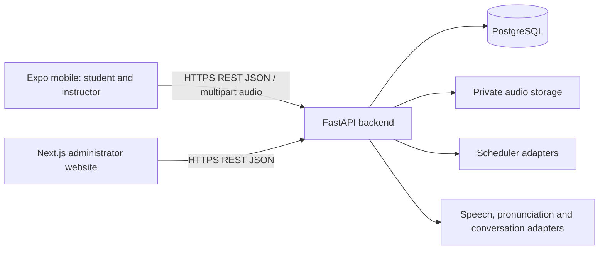

# FLUENTT architecture — Section 00

## Section 25 class communication

Read/write app/modules/communications composes existing device-session and owner/class/membership locks with the existing Message/MessageRead/AuditLog tables. Nullable contract/context/request fields in additive 0012 preserve legacy destinations while establishing class-text-v1, sender/key deduplication, ordered history, validated parties and immutable sent/read records. Expo /communication uses role guards, typed SessionController.run access, plain Text, controlled compose/retry state, explicit detail read marking and paged manual refresh. No provider, peer chat, websocket/push service, grade/answer-key link, research channel or new dependency. Synthetic demo retention only; real-student retention/moderation remains an activation prerequisite. See COMMUNICATIONS.md and OCT_21_DEMO_CHECKLIST.md.

## Section 24 instructor monitoring projection

Read-only app/modules/monitoring composes the existing instructor classroom transaction with shared progress query/result/metric helpers. It counts real first captures for current eligible members, derives unstarted opportunities without a class-wide assignment×roster materialization, and aggregates only pinned released objective runs. PostgreSQL grouping and Decimal mean calculation preserve engine/policy/version identity. Expo /instructor-monitoring reuses SessionController.run, protected role routing, Picker/history/UI patterns and explicit refresh; no alternate auth, analytics store, dependency or migration is added. INSTRUCTOR_MONITORING.md documents submission-counts-v1 and the approved released-assignment-mean-v1 boundary.

## Section 23 progress projection

The new read-only app/modules/progress composes existing classroom eligibility, published assignments, first student captures and immutable grading/release state. PostgreSQL counts trusted records and pages history before result enrichment; no duplicate activity/analytics store, migration, dependency or instructor monitoring is added. Expo /learning-history and the student dashboard reuse typed authenticated clients and existing UI/state patterns. Personal tracking stays explicitly unavailable without an approved writer; module/mastery/research metrics are not inferred. Head remains 0011_result_release (63 tables). PROGRESS.md describes submission-counts-v1, retained snapshots and current-member privacy.

## Section 22 results integration

The existing assignment module now composes immutable grading evidence with live classroom authorization and a separate append-only result-visibility ledger. Expo student/owner result routes reuse typed SessionController.run clients and controlled question widgets in readonly review mode. Only COMPLETE runs can be explicitly released, permanently pinned with withdrawal/re-release history; administrator-only engine execution remains separate. One additive table in 0011_result_release raises the domain count to 63. No answer-key query, research connection, notification service or grade mutation is added. RESULTS_AND_FEEDBACK.md specifies the approved boundary; earlier no-release statements remain historical.

Section 21 adds a backend-only grading module: a pure versioned objective engine and permission-gated transactional evaluation APIs. Two immutable sidecar tables (62 domain tables total) pin exact assignment/question/key/response evidence while leaving Section 20 captures untouched. New grading.read/run permissions are operator-granted; no client grading, result-release UI, scheduler or research computation is added. Engine identity records the Unicode database version used for approved case folding. See GRADING.md and SECTION_21_REPORT.md.

Section 20 adds a school-student capture route and typed session-wrapped client, reusing all ten controlled method widgets and the existing AssignmentAttempt/StudentResponse tables. An explicit unscored-capture-v1 contract permits one saved/resumable attempt and immutable final receipt against the frozen distribution-only assignment, without inventing grades/limits on published versions. Controlled Flashcard reveal is the only private-content exception. Additive 0009 guards prevent retakes, response mutation after submission, grading or latency collection. Ordinary educational records remain separate from research. See ASSIGNMENTS.md and SECTION_20_REPORT.md.

Section 19 extends the existing assignment module and Expo routes with explicit instructor publication and membership-authorized student metadata distribution. AssignmentVersion carries a frozen distribution-only-v1 contract/request identity; additive 0008 permits publication without inventing scoring/attempt configuration and rejects execution. No new service/table/client dependency or learner question-delivery channel is introduced. Live owner/class/membership locks, exact content IDs and shared content coordination preserve access and history. See ASSIGNMENTS.md and SECTION_19_REPORT.md.

Section 11 adds the FastAPI administrator question-bank domain (`app/modules/questions`), reusing Question/QuestionRevision/private key/competency tables and all ten V1 schemas. Live isolated admin permissions, atomic authoring/audits and immutable published revisions preserve pinned history. Migration 0006 adds same-lesson association guards; no table or client architecture changes. QUESTION_BANK.md documents safe previews and deferred delivery/scoring/research boundaries.

Section 10 adds the protected Next /curriculum structural-management workflow with FastAPI as the sole database/permission authority. Existing tables and snapshot guards are reused; no migration is needed beyond head 0005_constraint_names. Fixed BFF writes enforce Origin/CSRF and backend live permissions; authoring uses one locked authorization/write/audit transaction and whole-edition optimistic fingerprints. Published editions freeze and retire as a whole. See CURRICULUM.md and SECTION_10_REPORT.md; historical exclusions below retain their original milestone scope.

Section 09 now provides backend curriculum-structure reads over the existing version/grade/subject/quarter/topic/lesson/competency hierarchy. Published mobile reads and permission-gated admin reads remain separate; optional class scope enforces actual membership/ownership and grade/subject. Additive snapshot guards preserve published/historical hierarchy. Five research levels stay separate. CURRICULUM.md documents current contracts; earlier milestone notes below remain historical. No authoring/delivery/research execution is added.

Latest implemented administrator boundary: Section 08 adds provider-neutral OIDC with configured MFA evidence, operator-only provisioning and isolated PostgreSQL browser sessions. Next.js checks FastAPI before rendering protected account context and uses a fixed same-origin BFF; no admin business/database layer or fabricated metrics is added. See ADMIN_AUTH.md and SECTION_08_REPORT.md. Historical milestone notes below are retained.

Project: **FLUENTT: An Adaptive Language Learning System with Enhanced Spaced Repetition and NLP-Driven Pronunciation Modeling**. Client: NE Learning Inc. Stage: Undergraduate Computer Science Thesis 1.

## Inspection and scope

Inspected 2026-10-16: C:\Users\shang\Desktop\Fluent was empty (including hidden entries). No manifests, source code, assets, documentation, local or ancestor AGENTS.md files were found. Git reported that this directory is not a repository. There is no implementation or working behavior to preserve. Section 00 creates documentation only; no dependencies installed, database created, models downloaded, or runtime tests claimed.

The supplied Section 00 specification is the product baseline. All capabilities below are planned, not implemented. Later section numbering is unknown except database refinement in Section 02. See DEVELOPMENT_PLAN.md for provisional dependency gates.

## System boundaries



Only backend services access PostgreSQL and model credentials. Neither frontend embeds database credentials or vendor-specific model contracts. REST under /api/v1 is the public contract. Start with a modular backend process; introduce background workers only when speech processing duration requires them. No microservices are required.

## Proposed monorepo (future; not scaffolded)

```text
AGENTS.md
docs/
apps/
  mobile/                 # Expo, React Native, TypeScript, Expo Router
    app/                  # onboarding, student, instructor route groups
    src/features/         # profiles, classes, lessons, assessments, reviews,
                          # pronunciation, conversation, progress, messages
    src/components/
    src/services/         # API client, secure device session, audio
  admin/                  # Next.js, React, TypeScript
    src/app/
    src/features/         # users, curriculum, questions, research, operations
    src/components/
packages/
  api-client/             # generated TypeScript client from backend OpenAPI
  assessment-contracts/   # generated/shared method identifiers and payload types
services/
  api/
    app/
      main.py
      core/               # configuration, authorization, security, errors
      db/                 # engine, sessions, model registration
      modules/            # domain router/schema/service/repository/model units
      integrations/       # scheduling, tracing, speech, pronunciation, LLM
    migrations/           # Alembic
    tests/
infra/                    # later local services/deployment configuration
```

Use Python FastAPI, Pydantic, SQLAlchemy 2.x and Alembic with PostgreSQL. Select supported concrete dependency versions and lockfiles at scaffolding time. Use Expo Router consistently, not a second independent navigation system. Shared packages expose contracts, not database models or answer keys.

## Mobile architecture and access

One mobile app contains Student and Instructor portals. A root session gate validates the opaque device credential with the backend before restoring a profile. An expired/revoked credential returns to onboarding without looking up an account by username. A network failure offers retry and must not silently create a duplicate profile.

No valid session → “What will you use FLUENTT for?” → Personal Learning or School Learning.

- Personal: create globally unique username and profile → choose grade 1–12 → English or Tagalog → Student Dashboard. No class code required.
- School Student: create username and profile → enter six-digit class code → server validates and returns limited class information → explicitly confirm enrollment → Student Dashboard. Class supplies grade, subject and language context.
- School Instructor: create username and instructor profile → name first class → configure grade and language → server generates unique six-digit code → Instructor Dashboard. Additional classes follow later.

Profile/session creation is atomic. Onboarding progress is saved server-side so a valid session can resume an incomplete flow. Instructor accounts are self-created per the approved flow; classroom ownership does not grant research or administrative permissions. Personal learning language can change without rewriting historical activity. School assignments retain their class language and curriculum snapshot.

Student routes cover dashboard, lessons, school-only assignments, due vocabulary reviews, progress, scores/points, pronunciation, AI conversation, notifications and profile/settings. Instructor routes cover dashboard counts/pending work/performance, multiple classes, roster, code sharing, assignment builder, submissions/attempts/completion/progress/pronunciation summaries, feedback and messages. Route hiding is presentation only; backend authorization is mandatory.

Feature components use a shared API client and explicit loading, empty, retry and validation states. Keep server data separate from transient UI and recording state. Online submission is the initial reversible default; offline graded attempts require a later conflict/security design.

Assignment builder: class → grade → subject → curriculum version/quarter → topic → lesson → answer methods → select/create questions → points/attempts/timer/deadline → preview → publish. Validate selections against class context. Published assignment content and scoring rules are versioned snapshots.

## Assessments

Exactly ten methods: Multiple Choice, True or False, Identification, Fill in the Blank, Multiple Select, Flashcards, Error Identification, Word Arrangement, Sentence Arrangement, Matching Type. Stable identifiers and payload contracts are in API_DESIGN.md. Curriculum selection and answer-method selection remain independent.

Use a renderer registry plus shared submission envelope. Grade on the backend using versioned method-specific strategies. Objective item scoring, partial credit, accepted-answer normalization and flashcard recall grading need explicit policies before implementation; no hidden default fuzzy grader. Review flashcards use recall outcomes; scored flashcard assessments require a separate approved rubric. Pronunciation and conversation are activities, not additional answer methods.

## Administrator website

Next.js provides separately authenticated administrator routes: dashboard (users, instructors, classes, content, system activity, research overview); user/class/enrollment/permission management; versioned curriculum grades 1–12, subjects, quarters, topics, lessons and competencies; publish/archive; question bank with keys, difficulty and points; reference audio/practice phrases/conversation topics/model configuration; research enrollment, eligibility, consent/assent, codes, groups, tests and scheduler configuration; analytics and coded CSV exports; audit logs, permissions, data handling and settings.

Use server-controlled admin sessions, explicit permissions and audited mutations. Do not expose administrator selection in mobile onboarding. The website calls FastAPI for business operations; Next.js is not a second database access layer. Section 08 implements this boundary as documented in ADMIN_AUTH.md; full management modules in the paragraph above remain planned.

## Backend modules

Modules: identity, administration, classrooms, curriculum, assessments, assignments, progress, vocabulary, pronunciation, conversations, research, communications, audit. Each has Pydantic schemas, router, service and repository where needed. Transactions and authorization belong in services; routers translate HTTP, repositories perform persistence. SQLAlchemy sessions are request-scoped. Alembic is the sole schema migration path once implementation begins.

Research orchestration can invoke vocabulary and assessment services through explicit research context. Ordinary classroom services cannot mutate locked research fixtures. Integration interfaces return versioned results independent of vendors. Notifications use durable records; delivery channels remain a later decision.

## Security, privacy and research

See DECISIONS.md for session security, DATABASE_PLAN.md for identity separation and AI_INTEGRATION_PLAN.md for reproducibility. Protect enrollment previews and code validation with throttling; class codes are enumerable and never authentication or research consent. Restrict instructor reads to owned classes and relevant student activity, never all personal activity. Minimize student data, especially audio and conversation retention; durations and consent processes remain unresolved and must be approved before real collection.

Formal research is separate from classroom use: explicit approved enrollment, eligibility and required consent/assent; 30 participants, balanced 15 SM-2/15 ESR; controlled language, five learning levels, fixed assessment conditions, pre/post/delayed retention and optional separately approved pronunciation assessments. Group allocation and content lock versions are audited. Never silently substitute a scheduler for a research participant. Synthetic data only during early development.

## Quality and operations

Future checks: formatting/type checks and unit tests; API/OpenAPI contract checks; real PostgreSQL integration tests for uniqueness, transactions and access boundaries; migration upgrade tests; mobile/admin flow tests; provider contract and simulated-result labeling tests; research isolation, coded export and deterministic replay tests. Test the ten methods via meaningful grading fixtures, authorization and resubmission cases. Include device-session revocation, duplicate usernames, expired codes, deadline/timezone handling, audio failures and provider outages.

CI should run relevant checks for each change. Logs use request IDs and avoid tokens, raw audio and identifying research data. Monitor errors, provider latency/cost and failed jobs without collecting unnecessary text. Before deployment, define encrypted backups, restore verification, secrets rotation, HTTPS, restricted origins and environment-specific credentials. No operational controls have been implemented.

## Section 01 status

Foundation now lives in apps/mobile, apps/admin and services/api; see ../README.md and SECTION_01_REPORT.md for setup and validation. The proposed folder layout above is retained. Domain features described in this architecture remain planned. Only the public health API and initial frontend shells are implemented. The Section 01 prompt schedules admin authentication for Section 08.

## Section 02 database foundation

Implemented SQLAlchemy models live in services/api/app/models, grouped by domain, with shared metadata in app/db/base.py and synchronous request sessions in app/db/session.py. Alembic migrations live under services/api/migrations. The lifespan prepares an optional lazy engine and session factory without connecting, creating tables or applying migrations. Models and migration guards support the planned domains; ownership/authentication, grading, scheduling, AI and formal research services remain unimplemented. See DATABASE_SCHEMA.md for the complete implemented ERD and MIGRATIONS.md for setup and privacy boundaries.

The architecture's original schema inventory is conceptual history, not an assertion that every future service exists. Section 02 contains 58 domain tables, no populated curriculum/participant data and no frontend changes. Live PostgreSQL checks are blocked by unavailable local infrastructure; offline migration compilation and non-database tests are distinguished in SECTION_02_REPORT.md.

## Section 03 status

Implemented mobile username checking/creation and opaque device-session restoration/revocation through app/modules/identity, with shared username/security/throttling helpers in app/core. Public mobile roles are restricted; no administrator authentication or business-feature authorization is added. Existing PostgreSQL schema and migrations are unchanged. IDENTITY_AND_SESSIONS.md describes actual contracts and Section 04 integration; SECTION_03_REPORT.md distinguishes passing dependency-double tests from pending PostgreSQL verification.

## Section 04 onboarding

The mobile app now uses a root session provider and protected Expo Router screens. Startup validates the SecureStore credential before showing any profile. A network or storage error holds the startup gate with Retry; an HTTP 401 clears the invalid credential. Personal setup persists through PATCH /api/v1/users/me/preferences; restoration includes grade and language. School profiles remain at class-code/first-class boundaries until the later backend features actually complete onboarding.

The web build is a navigation preview: SecureStore is native-only, so web profile creation is blocked before POST /users. No browser-storage credential fallback is used. Android/iOS remains the intended onboarding runtime.

## Section 05 classrooms

The instructor form now creates classes through app/modules/classrooms and displays actual server-generated codes. My Classes lists owned records; details and edits enforce ownership in the backend. Authenticated session validation is shared transactionally with the class service. GET /sessions/me derives instructor completion from owned class records, preserving incomplete first-class restoration and avoiding duplicate profile creation. Student enrollment remains unimplemented.

Revision 0002_class_creation preserves 0001 and existing records, makes curriculum subject optional until explicitly configured, adds owner/request UUID deduplication and permanently unique historical invitation codes. See CLASSROOMS.md for contracts and Section 06 boundaries, MIGRATIONS.md for upgrade constraints, and SECTION_05_REPORT.md for validation limits.

## Section 06 enrollment

app/modules/enrollment provides school-student invitation preview, explicit transactional confirmation and own-membership listing. Multiple classes are supported; left members may create a new historical row, while removal blocks self-rejoining. Identity restoration derives school completion from eligible memberships, not a local/stored completion flag. Active membership remains independent of later invitation expiry. The mobile class-code route now shows real previews/confirmation and the student portal lists authenticated memberships. Existing instructor and personal paths remain in place. ENROLLMENT.md documents the reviewed optimistic preview marker and lock ordering; no new table/migration/provider/research feature is added. Section 07 dashboard/navigation work waits for Section 06 acceptance.

## Section 07 mobile experience

The existing Expo Router stack now exposes real role-based dashboards, shared account/logout navigation, personal preference editing and authorized school class selection. Backend membership/ownership contracts remain unchanged. Shared paged reads hide class data on loading/error and reject late responses after navigation. Session generations prevent results from an old session repopulating current protected state. Logout uses the existing revoke API, warns about absent recovery, and gates failed revocation/secure cleanup for retry. No second navigator, browser credential fallback, fabricated metrics or new backend service is introduced. See SECTION_07_REPORT.md.

## Personal focus and previous-screen navigation — 2026-10-19

The user replaced the personal grade-selector flow with self-described topic/lesson requests. The existing personal preferences endpoint now stores a bounded learning_focus object on LearnerProfile; new nullable JSONB is additive in 0013_learning_focus and preserves legacy grade data and all 63 tables. New setup uses focus and language; legacy grade-plus-language profiles remain compatible. These requests are not activity, delivered curriculum or inferred proficiency.

Both clients have shared previous-screen Back controls. Expo Screen composes BackButton with the existing navigator and unsaved attempt/editor guards. Next root layout renders a client BackButton; existing authoring managers intercept its cancelable event and reuse their confirmation dialogs. No alternate identity, storage, or authorization boundary is introduced.
