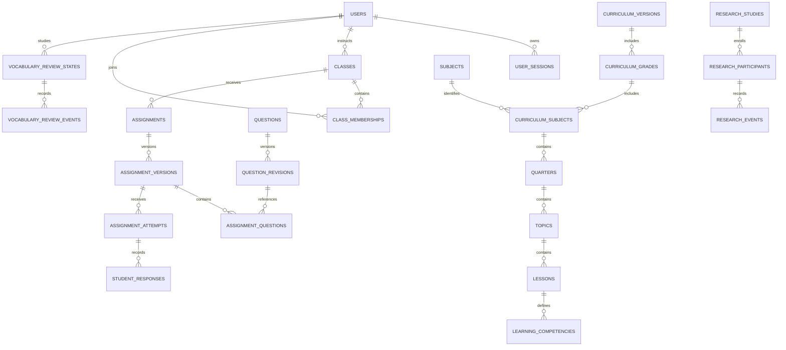

# Database plan

The inventory below records the conceptual Section 00 plan. Section 02 models and migrations now implement its refined schema; see [DATABASE_SCHEMA.md](DATABASE_SCHEMA.md) and the Section 02 notes below. No live database deployment has been performed here. Use UUID internal identifiers, UTC timestamp-with-time-zone fields, foreign keys, explicit deletion policies and version fields. UUIDs do not replace authorization.

## Entity inventory and relationships

| Domain | Planned entities and relationships |
|---|---|
| Identity | users(id, display_username, canonical_username UNIQUE, role, learning_mode, onboarding_status, disabled_at); learner_profiles(user_id UNIQUE, preferred_grade_id, language_track); instructor_profiles(user_id UNIQUE); user_sessions(user_id FK, token_digest UNIQUE, expiry, revoked_at); admin_identities(user_id FK, issuer, subject UNIQUE per issuer); roles, permissions, user_roles and role_permissions for administrative privileges |
| Classrooms | classes(owner_instructor_id FK, name, grade_id FK, subject_id FK, language_track, archived_at); class_join_codes(class_id FK, code, expires_at, revoked_at); class_memberships(class_id FK, student_id FK, status, confirmed_at), UNIQUE(class_id, student_id) |
| Curriculum | curriculum_versions(status, source/provenance, verification_status); grade_levels(number UNIQUE, CHECK 1–12); curriculum_grades(version_id FK, grade_id FK); subjects(code, official_label); curriculum_subjects(curriculum_grade_id FK, subject_id FK); quarters(curriculum_subject_id FK, ordinal); topics(quarter_id FK); lessons(topic_id FK, revision, publication_status); learning_competencies(lesson_id FK, code, description); question_competencies(question_revision_id FK, competency_id FK) |
| Questions | questions(author_id FK, stable identity); question_revisions(question_id FK, method, language_track, difficulty, default_points, version, status); question_content(question_revision_id UNIQUE FK, schema_version, JSONB public configuration); question_answer_keys(question_revision_id UNIQUE FK, rubric_version, private JSONB key); lesson_questions(lesson_id FK, question_revision_id FK) |
| Assignments | assignments(class_id FK, created_by FK, curriculum context, state); assignment_versions(assignment_id FK, revision, attempts_limit, timer_seconds, deadline, published_at); assignment_questions(assignment_version_id FK, question_revision_id FK, order, points); assignment_attempts(assignment_version_id FK, student_id FK, attempt_number, started_at, expires_at, submitted_at, status); student_responses(attempt_id FK, assignment_question_id FK, typed JSONB answer, latency_ms, score, grading_version) |
| Progress | learner_progress(user_id FK, lesson_id FK, activity_context, completion); score_summaries(user_id FK, source_attempt_id FK, aggregate_version) as derived projections; point_events(user_id FK, source_event_id UNIQUE, points) as ledger, never authoritative client totals |
| Vocabulary | vocabulary_items(language_track, text, meaning, curriculum linkage); vocabulary_review_states(user_id FK, vocabulary_item_id FK, context_id, scheduler_version_id FK, state JSONB, due_at, revision); vocabulary_review_events(state_id FK, event_id UNIQUE, recall, client_latency_ms, served_at, received_at, prior_state, next_state, scheduler/config version, activity context) |
| Speech | pronunciation_activities(lesson_id nullable FK, language_track, reference_text, reference_asset_id FK); media_assets(private object key, media metadata, retention/deletion state); pronunciation_attempts(user_id FK, activity_id FK, recording_asset_id FK, status, model/config IDs, result_schema_version, result JSONB, simulated) |
| Conversation | conversation_topics(language_track, curriculum context, allowed audience, version); conversation_sessions(user_id FK, topic_id FK, provider/config version); conversation_messages(session_id FK, sequence, role, content, retention metadata), retained only under approved policy |
| Research | research_studies(protocol_version, status, controlled_language, target_count=30); research_participants(study_id FK, participant_code UNIQUE per study, eligibility, enrollment_status); research_identity_links(participant_id UNIQUE FK, user_id FK) in restricted access boundary; research_consent_records(participant_id FK, consent/assent type, protocol_version, evidence reference, status, dates); research_groups(study_id FK, condition, scheduler_config_id FK, target_count=15); research_group_assignments(participant_id FK, group_id FK, allocation_version); research_levels(study_id FK, ordinal 1–5, frozen content version); research_assessments(study_id FK, kind pre/post/delayed/pronunciation, instrument_version, conditions); research_assessment_results(assessment_id FK, participant_id FK, scores, timing, attempt linkage); research_events(participant_id FK, phase, timestamps, event version, coded payload); research_content_locks(study_id FK, frozen artifact references) |
| Reproducibility | model_versions(provider, model identifier, task, supported/evaluated languages, artifact reference); model_configurations(model_version_id FK, immutable sanitized settings); scheduler_versions(algorithm, implementation version); scheduler_configurations(scheduler_version_id FK, immutable parameters); activity_contexts(kind personal/classroom/research, class_id nullable FK, research_participant_id nullable FK) |
| Operations | notifications(recipient_id FK, kind, read_at, safe payload); messages(sender_id FK, class_id nullable FK, recipient_id nullable FK, body, timestamps); audit_logs(actor_id nullable FK, action, resource, request_id, timestamp, redacted metadata); processing_jobs(owner_id FK, type, status, versioned result reference, failure code) |

## Relational outline

## Constraints and transaction boundaries

Published revisions are immutable; archive rather than changing historical questions or instruments. Distinguish official subject labels from language_track enum english/tagalog. Curriculum provenance includes source, license, reviewer and verification date; unverified examples must stay visibly unverified.

Enforce active code uniqueness through an active-code registry or explicit active flag with a partial unique index; expiry alone cannot serve as a time-dependent index predicate. Code rotation invalidates the previous code transactionally. Membership confirmation rechecks code validity and class status.

Unique attempt numbers per student/assignment version, one final submission per attempt, unique responses per attempt/question and unique request idempotency keys prevent duplicate scoring. Use row locking or optimistic version checks for review-state advancement, publish, allocation and final submissions. Server records timing; client latency is measured telemetry, not trusted proof of compliance.

A learner/item has separate review state per activity context and condition. A classroom review must not alter a research schedule. Research allocation needs an audited transaction enforcing approved 15/15 limits, one active group per participant and locked content/language. Five-level progression and assessment windows derive from the approved protocol, not arbitrary learner preferences.

Index canonical username, active code, membership lookups, class assignment deadlines, learner due_at, participant/time events and notification recipient/read status. Use JSONB only for discriminated method payloads, provider results and algorithm state; relational ownership and research identifiers remain explicit columns/FKs.

## Data handling

Only restricted research administration can resolve participant codes to identities; enforce through separate repository/schema grants and API permissions, not naming conventions. Coded exports use an allowlist excluding usernames, user IDs, identity links, free-text messages, tokens and audio locations. Coded data remains potentially re-identifiable and requires access control and export auditing.

Audio lives in private storage, with authorized short-lived access. No public object URLs. Retention, deletion and consent withdrawal rules require protocol approval, including whether retained research aggregates are allowed. Define deletion versus pseudonymization per entity before real data; avoid blanket cascading removal of audit/research evidence. Backups must follow the approved retention policy. No real participant data is seeded.

## Section 02 implementation

The conceptual inventory above is retained as the Section 00 plan. The implemented schema is now authoritative in services/api/app/models and documented in [DATABASE_SCHEMA.md](DATABASE_SCHEMA.md), including every table/column, relationship, constraint, index and a complete 58-table ERD. [MIGRATIONS.md](MIGRATIONS.md) documents setup, Alembic and disposable PostgreSQL tests.

Refinements: roles encode personal_student/school_student/instructor/administrator; optional learner/instructor profiles avoid duplicating users. Canonical usernames are generated under ASCII-compatible C collation and uniquely indexed. Curriculum grades/subjects are normalized joins. Question and assignment versions separate immutable grading content from lifecycle records. Learning contexts separate personal/class/research state; research contexts forbid user IDs, using research_private identity links instead. Review events derive student/item through state/context and retain their scheduler/configuration and state snapshots. Points are ledger transactions, not editable totals. Message reads are per-recipient records.

Study/group participant counts are configurable defaults 30/15, not global database limits. The Section 02 prompt supersedes provisional research scheduling: actual enrollment/randomization/execution belong to Sections 36–38. No media-assets/raw-recording storage, processing jobs, score projections or scheduler algorithms are implemented; those conceptual additions remain later dependencies. Model and scheduler configurations are versioned storage only.

SQLAlchemy metadata imports and offline Alembic compilation pass. PostgreSQL is not available/configured here, so live creation, constraints, drift comparison and downgrade/re-upgrade remain pending; see SECTION_02_REPORT.md for exact results. No existing database was altered and no data was seeded.

## Section 03 storage integration

No tables, columns, constraints or migration files changed. users.canonical_username still enforces global uniqueness; user_sessions stores only credential_digest, timestamps and revocation metadata. Identity services now atomically create the user, optional learner/instructor profile and session verifier. New public names are limited to 3–24 characters without whitespace; existing storage supports 3–32 and existing records are preserved. Canonical comparison is unchanged. Application session lifetimes use the existing expiry fields. See IDENTITY_AND_SESSIONS.md and SECTION_03_REPORT.md; actual PostgreSQL verification is still pending infrastructure.
