# Implemented database schema — Sections 02–25

## Personal history follow-up — 2026-10-21

Current source head is `0018_personal_history`, **71 domain tables**. One additive `personal_activity_events` ledger stores authenticated owner-only client-reported activity metadata with UUID replay identity/fingerprint, bounded public display snapshots, source/version, language and server time. No answers, audio, dialogue, grades, class/research contexts or scheduler state are added. It is append-only and separate from legacy progress readers. The local development database has now been forward-upgraded; prior Section 38B “source-only/unapplied” statements below are historical. Details and exact verification: [PERSONAL_HISTORY.md](PERSONAL_HISTORY.md).

## Section 38B Prompt 02 source addition

Current **source** head is `0017_research_classrooms`, following frozen 0001-0016: **70 domain tables**. Seven additive `research_private.classroom_*` tables hold opt-in study wrappers, immutable protocol revisions, classroom bindings, participant authorization references, assessment references, independent clearance history and contextual replay events. Existing study, coded participant, consent, allocation and instrument models are reused. Personal Learning and ordinary classroom tables remain unchanged; no backfill is performed. The existing research learning-context null-identity constraint is unchanged.

The migration was exercised only in generated disposable PostgreSQL databases. No developer/production database was upgraded for this prompt. Real activation requires independently verified approvals and non-owner runtime grants with SELECT-only clearance access; PUBLIC revocation alone does not constrain owners. See [SECTION_38B_02_REPORT.md](SECTION_38B_02_REPORT.md) for exact tables, guards, authorization and verification. Earlier source-head/table-count statements below describe historical sections.

Section 25 source head is 0012_class_communication, still 63 tables. Three nullable Message fields (communication_contract, context_class_id, send_request_id) preserve existing destinations and historical rows while class-text-v1 adds class-bound direct communication, owned announcements, sender/key uniqueness and indexed ordering. New invoker guards preserve sent/read history and validate allowed participants; PUBLIC access is revoked. Real-student retention/moderation remains unapproved; synthetic demo records only. See COMMUNICATIONS.md.

Section 22 source head is 0011_result_release. One append-only result visibility ledger increases the total to 63. Explicit owning-instructor release/withdraw/re-release pins one immutable COMPLETE classroom run; live student membership gates scores and original-answer review. Existing captures, grading outcomes and frozen 0001–0010 remain unchanged. See RESULTS_AND_FEEDBACK.md.

Section 21 source head is 0010_grading_results. Two additive immutable evaluation tables increase the total to 62 while preserving all original attempts, submitted responses and assignment/question/key versions. Live administrator grading.read/run controls backend-only computation; no student release or research grading. Engine/policy/Unicode identity, evidence FKs, natural idempotence and transactional sealing preserve auditable results. Frozen 0001–0009 remain unchanged. See GRADING.md; earlier section/count descriptions below are historical.

Section 20 source head is 0009_response_capture (60 tables). Existing AssignmentAttempt adds nullable capture_contract/capture_state/submission_fingerprint. One explicit unscored-capture-v1 attempt can save/resume raw partial responses and finalize once, retaining frozen distribution-only assignment versions and unset scoring/attempt fields. Guards prevent retakes, grading/latency and post-submit mutations; no historical rows are converted. Frozen 0001–0008 remain unchanged. ASSIGNMENTS.md defines controlled Flashcard reveal and the approved response/receipt boundary; earlier scope notes are historical.

Section 19 source head is 0008_assignment_publication (60 tables). AssignmentVersion adds nullable publication_contract/publication_request_id; explicitly marked distribution-only-v1 versions freeze with attempts/points/windows unset. Database guards reject attempts against them and preserve distributed root/version/item history. Existing configured values and frozen 0001–0007 remain unchanged. ASSIGNMENTS.md defines approved subject binding, live membership distribution and metadata-only student reads. The older section descriptions below are historical.

Section 06 reuses this unchanged schema for student enrollment and audit writes; no migration was added. See ENROLLMENT.md for approved multi-class/rejoining policies, transactional authorization and actual membership-based restoration. Earlier descriptions of future enrollment services below reflect the Section 05 storage milestone.

Generated from SQLAlchemy metadata by `services/api/scripts/document_schema.py`.
Models define the relational schema; `migrations/versions/0001_initial.py` freezes its initial DDL plus PostgreSQL guard functions. Revision 0002 adds class request identity, permanent code uniqueness and optional curriculum subjects.
Section 08 adds only separate digest-based administrator browser sessions and single-use OIDC attempts in revision 0003_admin_sessions. Existing mobile identities, RBAC mappings, research guards and frozen migrations are preserved. See ADMIN_AUTH.md for application authorization and provisioning.
Section 09 reuses all tables and IDs for curriculum structure reads. Revision 0004_curriculum_snapshots adds only hierarchy/reference/history guards and a transaction advisory read/write boundary; published versions and previously assigned/completed hierarchy are preserved. See CURRICULUM.md for lifecycle and safe read contracts. No content or new domain table is seeded.
There are 63 domain tables; Alembic also manages its own `alembic_version` table.
Post-Section 09 local PostgreSQL verification now executes the integration suite. Revision 0005_constraint_names converges three constraint names without changing integrity or stored data. Fresh empty databases require the explicit execution adapter documented in MIGRATIONS.md; frozen migration files remain unchanged. See LOCAL_VERIFICATION_REPORT.md for evidence and remaining deployment gates.

Section 18 source head is 0007_assignment_drafts. Assignment creation adds nullable creation_request_id/fingerprint with per-instructor UUID uniqueness; new draft max_attempts and item points are explicitly NULL, with no policy inferred. Existing values remain intact. A new guard refuses locking until both are configured. Owner-only draft APIs pin locked question revisions and safe curriculum context; no student publication, attempts or grading. See ASSIGNMENTS.md.

## Responsibilities and conventions

- Identity: users, optional learner/instructor attributes, separate digest-only mobile/admin sessions, digest-only OIDC attempts and administrative identity/permission mappings. A generated canonical username lowercases ASCII under C collation; the username format and uniqueness are enforced by PostgreSQL. ORM input trims surrounding whitespace first. No password field exists. Browser idle/absolute expiry and one-use attempt consumption are enforced transactionally in the administrator service.
- Classes: ownership, grade, optional school subject and distinct learning language, code history and memberships. Class creation does not infer a curriculum subject from language. Six-digit strings preserve leading zeros; a permanent unique code constraint prevents historical reuse; partial unique indexes additionally allow one active code per class. Owner/request UUID uniqueness makes creation retries idempotent. Expiry must be checked by the future enrollment service and stale codes explicitly marked expired. Historical inactive memberships can coexist; duplicate active enrollment cannot.
- Curriculum: version → curriculum-grade → curriculum-subject → quarter → topic → lesson → competency. Grade and subject reference records are reusable. No official curriculum is seeded; provenance starts unverified. Future content services must create new curriculum versions instead of relabeling historical materials.
- Assessments: stable question identity, immutable-when-locked revisions, separate private answer keys and competency links. Assignment identity separates lifecycle status from frozen assignment versions/items. Attempts and responses retain original version associations; composite foreign keys reject responses from a different assignment version.
- Learning: progress and review state belong to personal/classroom/research contexts. Personal/classroom contexts require a student ID. Research contexts require a participant ID and forbid student/class IDs, avoiding a public identity bridge. Review histories preserve scheduler configuration and previous/resulting states; no algorithm is executed here. Event student/item associations are normalized through state/context, not duplicated on every event.
- AI activities: pronunciation reference metadata, independent ASR/evaluator configurations and optional score only in scored status; no raw recording column. Conversation retention defaults off and requires a policy version and deletion deadline before inserts are accepted. No speech pipeline, retention worker or LLM is implemented.
- Research: configurable study/group targets (defaults 30 and 15, not permanent caps), coded participants, private identity/consent, append-only allocation history, controlled levels 1–5, versioned instrument snapshots/results/events and immutable model/scheduler configurations. No enrollment, allocation or experiment execution logic is implemented.
- Communications/operations: class-text-v1 direct/announcement APIs reuse messages and immutable own-viewer message_reads. Direct context_class_id supplements the preserved recipient-versus-class destination rule. No peer/personal chat, automatic notifications, receipt sharing, editing or permanent deletion. Legacy unclassified rows stay untouched and excluded. Inbox notification storage remains unused; audits omit message text. Notification resource IDs and audit entity IDs are optional typed references, not polymorphic foreign keys; future API code must validate them.

All domain tables have UUID primary keys with application/server generation and non-null timezone-aware created_at/updated_at fields. The session uses UTC, and database triggers maintain updated_at even for direct SQL updates. Localized display is a frontend concern. Most foreign keys use RESTRICT; legacy deletion of a conversation session or message can cascade only to its disposable message/read children; class-text-v1 sent messages and receipts reject deletion. Archival/status changes are preferred to deleting referenced records. Application roles must not own schema objects or have TRUNCATE/trigger-disabling privileges.

Only the backend accesses the database. The separate research_private schema revokes PUBLIC access, but its owner/superusers still have access. Production must use distinct migration, ordinary runtime and restricted research credentials/grants; a shared owner credential is not a privacy boundary. No production roles or grants to runtime users are provisioned automatically. Coded exports need future allowlisting and auditing, and must exclude profile IDs, usernames, identity links, consent evidence, free text and credentials.

## PostgreSQL guards outside metadata

- Section 09 freezes published/retired curriculum metadata, descendant links/ordering and referenced global grade/subject labels; legacy draft hierarchy referenced by assignments/progress is protected too. Root retirement preserves content/IDs and publication evidence. All structure writes and history reference changes share an exclusive advisory boundary; reads use its shared form. Future writers must lock before DML. Local PostgreSQL guard checks now execute; deployment grants/performance remain separate gates. See CURRICULUM.md and LOCAL_VERIFICATION_REPORT.md.

- Locked question/assignment versions cannot change or be deleted. A question must start as a draft, have an answer key, then be locked. Assignment locking requires nonempty items with locked question revisions; attempts require a locked assignment version. Parent-row locking serializes child edits against publishing.
- Keys/competency links and assignment items cannot change once their parent revision is locked. New revisions are the update mechanism. Grading algorithms and release/rubric policies remain future work.
- Model versions/configurations, scheduler configurations, review events, points transactions, research allocations/events, consent events, audit logs and learning contexts are append-only. Corrections use new records; policy-approved erasure needs a separately reviewed migration/privileged process.
- A locked study freezes its protocol fields, groups, levels and instruments. Study status and end date remain changeable. Allocation history is append-only; protocol eligibility, balanced allocation, consecutive history numbering, language control and consent gates require future services (Sections 36–38).
- Review state ownership/item/scheduler cannot change; event replay retains its own scheduler reference. Future review services must advance revision/state and append events atomically and verify matching configurations.
- Conversation message writes fail unless the session explicitly permits unexpired retention. Deletion scheduling and consent validation remain future work.

These triggers are in the migration, not Alembic autogeneration. Future revisions must explicitly preserve/update them. The generated SQL files are review artifacts; run Alembic rather than executing them and Alembic twice.

## Complete ERD

All 63 domain tables are represented below, including research_private tables (prefixed research_private_). Nodes show keys; the dictionary below documents every implemented column. Relationships derive from all foreign-key constraints, including composite constraints. Optional and unique foreign keys use optional/one cardinality where applicable. This schema does not by itself enforce per-request authorization.

```mermaid
erDiagram
  admin_oidc_attempts {
    string id PK
  }
  admin_permissions {
    string id PK
  }
  admin_roles {
    string id PK
  }
  curriculum_versions {
    string id PK
  }
  grade_levels {
    string id PK
  }
  model_versions {
    string id PK
  }
  research_studies {
    string id PK
  }
  subjects {
    string id PK
  }
  users {
    string id PK
  }
  admin_browser_sessions {
    string user_id FK
    string id PK
  }
  admin_identities {
    string user_id FK
    string id PK
  }
  admin_role_permissions {
    string role_id FK
    string permission_id FK
    string id PK
  }
  admin_user_roles {
    string user_id FK
    string role_id FK
    string id PK
  }
  audit_logs {
    string actor_id FK
    string id PK
  }
  classes {
    string instructor_id FK
    string grade_level_id FK
    string subject_id FK
    string id PK
  }
  curriculum_grades {
    string curriculum_version_id FK
    string grade_level_id FK
    string id PK
  }
  instructor_profiles {
    string user_id FK
    string id PK
  }
  learner_profiles {
    string user_id FK
    string preferred_grade_id FK
    string id PK
  }
  model_configurations {
    string model_version_id FK
    string id PK
  }
  notifications {
    string user_id FK
    string id PK
  }
  questions {
    string author_id FK
    string id PK
  }
  research_levels {
    string study_id FK
    string id PK
  }
  research_participants {
    string study_id FK
    string id PK
  }
  user_sessions {
    string user_id FK
    string id PK
  }
  assignments {
    string class_id FK
    string instructor_id FK
    string id PK
  }
  class_join_codes {
    string class_id FK
    string id PK
  }
  class_memberships {
    string class_id FK
    string student_id FK
    string id PK
  }
  curriculum_subjects {
    string curriculum_grade_id FK
    string subject_id FK
    string id PK
  }
  learning_contexts {
    string student_id FK
    string class_id FK
    string participant_id FK
    string id PK
  }
  messages {
    string sender_id FK
    string recipient_id FK
    string class_id FK
    string context_class_id FK
    string id PK
  }
  research_assessments {
    string study_id FK
    string level_id FK
    string id PK
  }
  research_events {
    string participant_id FK
    string id PK
  }
  research_private_research_consent_records {
    string participant_id FK
    string id PK
  }
  research_private_research_identity_links {
    string participant_id FK
    string study_id FK
    string user_id FK
    string id PK
  }
  scheduler_configurations {
    string model_configuration_id FK
    string id PK
  }
  message_reads {
    string message_id FK
    string user_id FK
    string id PK
  }
  points_transactions {
    string context_id FK
    string reverses_id FK
    string id PK
  }
  quarters {
    string curriculum_subject_id FK
    string id PK
  }
  research_assessment_results {
    string assessment_id FK
    string participant_id FK
    string study_id FK
    string model_configuration_id FK
    string id PK
  }
  research_groups {
    string study_id FK
    string scheduler_configuration_id FK
    string id PK
  }
  curriculum_topics {
    string quarter_id FK
    string id PK
  }
  research_group_assignments {
    string participant_id FK
    string group_id FK
    string study_id FK
    string supersedes_id FK
    string id PK
  }
  lessons {
    string topic_id FK
    string id PK
  }
  assignment_versions {
    string assignment_id FK
    string lesson_id FK
    string id PK
  }
  conversation_topics {
    string lesson_id FK
    string id PK
  }
  learner_progress {
    string context_id FK
    string lesson_id FK
    string id PK
  }
  learning_competencies {
    string lesson_id FK
    string id PK
  }
  pronunciation_activities {
    string lesson_id FK
    string id PK
  }
  question_revisions {
    string question_id FK
    string lesson_id FK
    string id PK
  }
  vocabulary_items {
    string lesson_id FK
    string id PK
  }
  assignment_attempts {
    string assignment_version_id FK
    string student_id FK
    string id PK
  }
  assignment_questions {
    string assignment_version_id FK
    string question_revision_id FK
    string id PK
  }
  conversation_sessions {
    string context_id FK
    string topic_id FK
    string model_configuration_id FK
    string id PK
  }
  pronunciation_attempts {
    string context_id FK
    string activity_id FK
    string asr_configuration_id FK
    string evaluator_configuration_id FK
    string id PK
  }
  question_answer_keys {
    string question_revision_id FK
    string id PK
  }
  question_competencies {
    string question_revision_id FK
    string competency_id FK
    string id PK
  }
  vocabulary_review_states {
    string context_id FK
    string vocabulary_item_id FK
    string scheduler_configuration_id FK
    string id PK
  }
  conversation_messages {
    string session_id FK
    string id PK
  }
  grading_runs {
    string attempt_id FK
    string assignment_version_id FK
    string actor_id FK
    string id PK
  }
  student_responses {
    string attempt_id FK
    string assignment_question_id FK
    string assignment_version_id FK
    string id PK
  }
  vocabulary_review_events {
    string review_state_id FK
    string scheduler_configuration_id FK
    string id PK
  }
  assessment_result_releases {
    string attempt_id FK
    string run_id FK
    string assignment_version_id FK
    string actor_id FK
    string id PK
  }
  grading_item_results {
    string run_id FK
    string assignment_version_id FK
    string assignment_question_id FK
    string question_revision_id FK
    string response_id FK
    string key_id FK
    string id PK
  }
  users ||--o{ admin_browser_sessions : "user_id"
  users ||--o| admin_identities : "user_id"
  admin_permissions ||--o{ admin_role_permissions : "permission_id"
  admin_roles ||--o{ admin_role_permissions : "role_id"
  admin_roles ||--o{ admin_user_roles : "role_id"
  users ||--o{ admin_user_roles : "user_id"
  users |o--o{ audit_logs : "actor_id"
  grade_levels ||--o{ classes : "grade_level_id"
  users ||--o{ classes : "instructor_id"
  subjects |o--o{ classes : "subject_id"
  curriculum_versions ||--o{ curriculum_grades : "curriculum_version_id"
  grade_levels ||--o{ curriculum_grades : "grade_level_id"
  users ||--o| instructor_profiles : "user_id"
  grade_levels |o--o{ learner_profiles : "preferred_grade_id"
  users ||--o| learner_profiles : "user_id"
  model_versions ||--o{ model_configurations : "model_version_id"
  users ||--o{ notifications : "user_id"
  users |o--o{ questions : "author_id"
  research_studies ||--o{ research_levels : "study_id"
  research_studies ||--o{ research_participants : "study_id"
  users ||--o{ user_sessions : "user_id"
  classes ||--o{ assignments : "class_id"
  users ||--o{ assignments : "instructor_id"
  classes ||--o{ class_join_codes : "class_id"
  classes ||--o{ class_memberships : "class_id"
  users ||--o{ class_memberships : "student_id"
  curriculum_grades ||--o{ curriculum_subjects : "curriculum_grade_id"
  subjects ||--o{ curriculum_subjects : "subject_id"
  classes |o--o{ learning_contexts : "class_id"
  research_participants |o--o{ learning_contexts : "participant_id"
  users |o--o{ learning_contexts : "student_id"
  classes |o--o{ messages : "class_id"
  classes |o--o{ messages : "context_class_id"
  users |o--o{ messages : "recipient_id"
  users ||--o{ messages : "sender_id"
  research_levels |o--o{ research_assessments : "level_id,study_id"
  research_studies ||--o{ research_assessments : "study_id"
  research_participants ||--o{ research_events : "participant_id"
  research_participants ||--o{ research_private_research_consent_records : "participant_id"
  research_participants ||--o{ research_private_research_identity_links : "participant_id,study_id"
  research_studies ||--o{ research_private_research_identity_links : "study_id"
  users ||--o{ research_private_research_identity_links : "user_id"
  model_configurations |o--o{ scheduler_configurations : "model_configuration_id"
  messages ||--o{ message_reads : "message_id"
  users ||--o{ message_reads : "user_id"
  learning_contexts ||--o{ points_transactions : "context_id"
  points_transactions |o--o| points_transactions : "reverses_id"
  curriculum_subjects ||--o{ quarters : "curriculum_subject_id"
  research_assessments ||--o{ research_assessment_results : "assessment_id,study_id"
  model_configurations |o--o{ research_assessment_results : "model_configuration_id"
  research_participants ||--o{ research_assessment_results : "participant_id,study_id"
  scheduler_configurations ||--o{ research_groups : "scheduler_configuration_id"
  research_studies ||--o{ research_groups : "study_id"
  quarters ||--o{ curriculum_topics : "quarter_id"
  research_groups ||--o{ research_group_assignments : "group_id,study_id"
  research_participants ||--o{ research_group_assignments : "participant_id,study_id"
  research_group_assignments |o--o{ research_group_assignments : "supersedes_id,participant_id"
  curriculum_topics ||--o{ lessons : "topic_id"
  assignments ||--o{ assignment_versions : "assignment_id"
  lessons ||--o{ assignment_versions : "lesson_id"
  lessons |o--o{ conversation_topics : "lesson_id"
  learning_contexts ||--o{ learner_progress : "context_id"
  lessons ||--o{ learner_progress : "lesson_id"
  lessons ||--o{ learning_competencies : "lesson_id"
  lessons |o--o{ pronunciation_activities : "lesson_id"
  lessons ||--o{ question_revisions : "lesson_id"
  questions ||--o{ question_revisions : "question_id"
  lessons ||--o{ vocabulary_items : "lesson_id"
  assignment_versions ||--o{ assignment_attempts : "assignment_version_id"
  users ||--o{ assignment_attempts : "student_id"
  assignment_versions ||--o{ assignment_questions : "assignment_version_id"
  question_revisions ||--o{ assignment_questions : "question_revision_id"
  learning_contexts ||--o{ conversation_sessions : "context_id"
  model_configurations ||--o{ conversation_sessions : "model_configuration_id"
  conversation_topics ||--o{ conversation_sessions : "topic_id"
  pronunciation_activities ||--o{ pronunciation_attempts : "activity_id"
  model_configurations |o--o{ pronunciation_attempts : "asr_configuration_id"
  learning_contexts ||--o{ pronunciation_attempts : "context_id"
  model_configurations |o--o{ pronunciation_attempts : "evaluator_configuration_id"
  question_revisions ||--o| question_answer_keys : "question_revision_id"
  learning_competencies ||--o{ question_competencies : "competency_id"
  question_revisions ||--o{ question_competencies : "question_revision_id"
  learning_contexts ||--o{ vocabulary_review_states : "context_id"
  scheduler_configurations ||--o{ vocabulary_review_states : "scheduler_configuration_id"
  vocabulary_items ||--o{ vocabulary_review_states : "vocabulary_item_id"
  conversation_sessions ||--o{ conversation_messages : "session_id"
  users ||--o{ grading_runs : "actor_id"
  assignment_versions ||--o{ grading_runs : "assignment_version_id"
  assignment_attempts ||--o{ grading_runs : "attempt_id"
  assignment_attempts ||--o{ grading_runs : "attempt_id,assignment_version_id"
  assignment_questions ||--o{ student_responses : "assignment_question_id,assignment_version_id"
  assignment_attempts ||--o{ student_responses : "attempt_id,assignment_version_id"
  vocabulary_review_states ||--o{ vocabulary_review_events : "review_state_id"
  scheduler_configurations ||--o{ vocabulary_review_events : "scheduler_configuration_id"
  vocabulary_review_states ||--o{ vocabulary_review_events : "review_state_id,scheduler_configuration_id"
  users ||--o{ assessment_result_releases : "actor_id"
  assignment_versions ||--o{ assessment_result_releases : "assignment_version_id"
  assignment_attempts ||--o{ assessment_result_releases : "attempt_id"
  grading_runs ||--o{ assessment_result_releases : "run_id"
  grading_runs ||--o{ assessment_result_releases : "run_id,assignment_version_id"
  assignment_questions ||--o{ grading_item_results : "assignment_question_id"
  assignment_versions ||--o{ grading_item_results : "assignment_version_id"
  question_answer_keys |o--o{ grading_item_results : "key_id"
  question_revisions ||--o{ grading_item_results : "question_revision_id"
  student_responses |o--o{ grading_item_results : "response_id"
  grading_runs ||--o{ grading_item_results : "run_id"
  assignment_questions ||--o{ grading_item_results : "assignment_question_id,assignment_version_id"
  grading_runs ||--o{ grading_item_results : "run_id,assignment_version_id"
```

## Data dictionary

Every table includes the Entity mixin fields. Defaults shown below are server defaults; application defaults may also exist. CHECK enum lists are stored as VARCHAR + named CHECK constraints, not native PostgreSQL enum types.

### admin_oidc_attempts

| Column | PostgreSQL type | Required | Key / reference / server default |
|---|---|---|---|
| state_digest | VARCHAR(64) | yes | — |
| binding_digest | VARCHAR(64) | yes | — |
| expires_at | TIMESTAMP WITH TIME ZONE | yes | — |
| consumed_at | TIMESTAMP WITH TIME ZONE | no | — |
| id | UUID | yes | PK; Default: gen_random_uuid() |
| created_at | TIMESTAMP WITH TIME ZONE | yes | Default: now() |
| updated_at | TIMESTAMP WITH TIME ZONE | yes | Default: now() |

Constraints:

- `ck_admin_oidc_attempts_digest_format`: state_digest ~ '^[0-9a-f]{64}$' AND binding_digest ~ '^[0-9a-f]{64}$'
- `ck_admin_oidc_attempts_expiry_order`: expires_at > created_at
- `pk_admin_oidc_attempts`: PrimaryKeyConstraint (id)
- `uq_admin_oidc_attempts_state_digest`: UniqueConstraint (state_digest)

Indexes:

- Primary/unique constraint indexes only.

### admin_permissions

| Column | PostgreSQL type | Required | Key / reference / server default |
|---|---|---|---|
| code | VARCHAR(100) | yes | — |
| id | UUID | yes | PK; Default: gen_random_uuid() |
| created_at | TIMESTAMP WITH TIME ZONE | yes | Default: now() |
| updated_at | TIMESTAMP WITH TIME ZONE | yes | Default: now() |

Constraints:

- `pk_admin_permissions`: PrimaryKeyConstraint (id)
- `uq_admin_permissions_code`: UniqueConstraint (code)

Indexes:

- Primary/unique constraint indexes only.

### admin_roles

| Column | PostgreSQL type | Required | Key / reference / server default |
|---|---|---|---|
| name | VARCHAR(80) | yes | — |
| description | TEXT | no | — |
| id | UUID | yes | PK; Default: gen_random_uuid() |
| created_at | TIMESTAMP WITH TIME ZONE | yes | Default: now() |
| updated_at | TIMESTAMP WITH TIME ZONE | yes | Default: now() |

Constraints:

- `pk_admin_roles`: PrimaryKeyConstraint (id)
- `uq_admin_roles_name`: UniqueConstraint (name)

Indexes:

- Primary/unique constraint indexes only.

### curriculum_versions

| Column | PostgreSQL type | Required | Key / reference / server default |
|---|---|---|---|
| code | VARCHAR(80) | yes | — |
| name | VARCHAR(200) | yes | — |
| description | TEXT | no | — |
| status | VARCHAR(9) | yes | Default: draft |
| source_metadata | JSONB | yes | Default: '{}'::jsonb |
| verification_status | VARCHAR(10) | yes | Default: unverified |
| published_at | TIMESTAMP WITH TIME ZONE | no | — |
| archived_at | TIMESTAMP WITH TIME ZONE | no | — |
| id | UUID | yes | PK; Default: gen_random_uuid() |
| created_at | TIMESTAMP WITH TIME ZONE | yes | Default: now() |
| updated_at | TIMESTAMP WITH TIME ZONE | yes | Default: now() |

Constraints:

- `ck_curriculum_versions_publication`: curriculum_versions.status IN ('draft', 'published', 'archived')
- `ck_curriculum_versions_verification`: curriculum_versions.verification_status IN ('unverified', 'verified')
- `pk_curriculum_versions`: PrimaryKeyConstraint (id)
- `uq_curriculum_versions_code`: UniqueConstraint (code)

Indexes:

- Primary/unique constraint indexes only.

### grade_levels

| Column | PostgreSQL type | Required | Key / reference / server default |
|---|---|---|---|
| number | INTEGER | yes | — |
| name | VARCHAR(200) | yes | — |
| id | UUID | yes | PK; Default: gen_random_uuid() |
| created_at | TIMESTAMP WITH TIME ZONE | yes | Default: now() |
| updated_at | TIMESTAMP WITH TIME ZONE | yes | Default: now() |

Constraints:

- `ck_grade_levels_grade_range`: number BETWEEN 1 AND 12
- `pk_grade_levels`: PrimaryKeyConstraint (id)
- `uq_grade_levels_number`: UniqueConstraint (number)

Indexes:

- Primary/unique constraint indexes only.

### model_versions

| Column | PostgreSQL type | Required | Key / reference / server default |
|---|---|---|---|
| task | VARCHAR(60) | yes | — |
| provider | VARCHAR(100) | yes | — |
| model_name | VARCHAR(150) | yes | — |
| version | VARCHAR(100) | yes | — |
| capabilities | JSONB | yes | Default: '{}'::jsonb |
| artifact_reference | TEXT | no | — |
| simulated | BOOLEAN | yes | Default: false |
| id | UUID | yes | PK; Default: gen_random_uuid() |
| created_at | TIMESTAMP WITH TIME ZONE | yes | Default: now() |
| updated_at | TIMESTAMP WITH TIME ZONE | yes | Default: now() |

Constraints:

- `pk_model_versions`: PrimaryKeyConstraint (id)
- `uq_model_versions_task`: UniqueConstraint (task, provider, model_name, version)

Indexes:

- Primary/unique constraint indexes only.

### research_studies

| Column | PostgreSQL type | Required | Key / reference / server default |
|---|---|---|---|
| code | VARCHAR(80) | yes | — |
| title | VARCHAR(200) | yes | — |
| status | VARCHAR(9) | yes | Default: draft |
| target_language | VARCHAR(7) | yes | — |
| protocol_version | VARCHAR(80) | yes | — |
| target_participants | INTEGER | yes | Default: 30 |
| starts_at | TIMESTAMP WITH TIME ZONE | no | — |
| ends_at | TIMESTAMP WITH TIME ZONE | no | — |
| conditions | JSONB | yes | Default: '{}'::jsonb |
| locked_at | TIMESTAMP WITH TIME ZONE | no | — |
| id | UUID | yes | PK; Default: gen_random_uuid() |
| created_at | TIMESTAMP WITH TIME ZONE | yes | Default: now() |
| updated_at | TIMESTAMP WITH TIME ZONE | yes | Default: now() |

Constraints:

- `ck_research_studies_language`: research_studies.target_language IN ('english', 'tagalog')
- `ck_research_studies_positive_target`: target_participants > 0
- `ck_research_studies_study_dates`: ends_at IS NULL OR starts_at IS NULL OR ends_at >= starts_at
- `ck_research_studies_study_status`: research_studies.status IN ('draft', 'approved', 'active', 'completed', 'archived')
- `pk_research_studies`: PrimaryKeyConstraint (id)
- `uq_research_studies_code`: UniqueConstraint (code)

Indexes:

- Primary/unique constraint indexes only.

### subjects

| Column | PostgreSQL type | Required | Key / reference / server default |
|---|---|---|---|
| code | VARCHAR(50) | yes | — |
| name | VARCHAR(200) | yes | — |
| description | TEXT | no | — |
| id | UUID | yes | PK; Default: gen_random_uuid() |
| created_at | TIMESTAMP WITH TIME ZONE | yes | Default: now() |
| updated_at | TIMESTAMP WITH TIME ZONE | yes | Default: now() |

Constraints:

- `pk_subjects`: PrimaryKeyConstraint (id)
- `uq_subjects_code`: UniqueConstraint (code)

Indexes:

- Primary/unique constraint indexes only.

### users

| Column | PostgreSQL type | Required | Key / reference / server default |
|---|---|---|---|
| username | VARCHAR(32) | yes | — |
| canonical_username | VARCHAR(32) | yes | Generated: lower(btrim(username) COLLATE "C") |
| role | VARCHAR(16) | yes | — |
| profile_status | VARCHAR(10) | yes | Default: onboarding |
| onboarding_step | VARCHAR(80) | no | — |
| archived_at | TIMESTAMP WITH TIME ZONE | no | — |
| id | UUID | yes | PK; Default: gen_random_uuid() |
| created_at | TIMESTAMP WITH TIME ZONE | yes | Default: now() |
| updated_at | TIMESTAMP WITH TIME ZONE | yes | Default: now() |

Constraints:

- `ck_users_profile_status`: users.profile_status IN ('onboarding', 'active', 'disabled', 'archived')
- `ck_users_role`: users.role IN ('personal_student', 'school_student', 'instructor', 'administrator')
- `ck_users_username_format`: username ~ '^[A-Za-z0-9_]{3,32}$'
- `pk_users`: PrimaryKeyConstraint (id)
- `uq_users_canonical_username`: UniqueConstraint (canonical_username)

Indexes:

- Primary/unique constraint indexes only.

### admin_browser_sessions

| Column | PostgreSQL type | Required | Key / reference / server default |
|---|---|---|---|
| user_id | UUID | yes | FK → users.id (RESTRICT) |
| credential_digest | VARCHAR(64) | yes | — |
| expires_at | TIMESTAMP WITH TIME ZONE | yes | — |
| absolute_expires_at | TIMESTAMP WITH TIME ZONE | yes | — |
| revoked_at | TIMESTAMP WITH TIME ZONE | no | — |
| id | UUID | yes | PK; Default: gen_random_uuid() |
| created_at | TIMESTAMP WITH TIME ZONE | yes | Default: now() |
| updated_at | TIMESTAMP WITH TIME ZONE | yes | Default: now() |

Constraints:

- `ck_admin_browser_sessions_digest_format`: credential_digest ~ '^[0-9a-f]{64}$'
- `ck_admin_browser_sessions_expiry_order`: expires_at > created_at AND absolute_expires_at >= expires_at
- `fk_admin_browser_sessions_user_id_users`: FK (user_id) → users.id
- `pk_admin_browser_sessions`: PrimaryKeyConstraint (id)
- `uq_admin_browser_sessions_credential_digest`: UniqueConstraint (credential_digest)

Indexes:

- `CREATE INDEX ix_admin_browser_sessions_active ON admin_browser_sessions (user_id, expires_at) WHERE revoked_at IS NULL`
- `CREATE INDEX ix_admin_browser_sessions_user_id ON admin_browser_sessions (user_id)`

### admin_identities

| Column | PostgreSQL type | Required | Key / reference / server default |
|---|---|---|---|
| user_id | UUID | yes | FK → users.id (RESTRICT) |
| issuer | VARCHAR(255) | yes | — |
| subject | VARCHAR(255) | yes | — |
| id | UUID | yes | PK; Default: gen_random_uuid() |
| created_at | TIMESTAMP WITH TIME ZONE | yes | Default: now() |
| updated_at | TIMESTAMP WITH TIME ZONE | yes | Default: now() |

Constraints:

- `fk_admin_identities_user_id_users`: FK (user_id) → users.id
- `pk_admin_identities`: PrimaryKeyConstraint (id)
- `uq_admin_identities_issuer`: UniqueConstraint (issuer, subject)

Indexes:

- `CREATE UNIQUE INDEX ix_admin_identities_user_id ON admin_identities (user_id)`

### admin_role_permissions

| Column | PostgreSQL type | Required | Key / reference / server default |
|---|---|---|---|
| role_id | UUID | yes | FK → admin_roles.id (RESTRICT) |
| permission_id | UUID | yes | FK → admin_permissions.id (RESTRICT) |
| id | UUID | yes | PK; Default: gen_random_uuid() |
| created_at | TIMESTAMP WITH TIME ZONE | yes | Default: now() |
| updated_at | TIMESTAMP WITH TIME ZONE | yes | Default: now() |

Constraints:

- `fk_admin_role_permissions_permission_id_admin_permissions`: FK (permission_id) → admin_permissions.id
- `fk_admin_role_permissions_role_id_admin_roles`: FK (role_id) → admin_roles.id
- `pk_admin_role_permissions`: PrimaryKeyConstraint (id)
- `uq_admin_role_permissions_role_id`: UniqueConstraint (role_id, permission_id)

Indexes:

- `CREATE INDEX ix_admin_role_permissions_permission_id ON admin_role_permissions (permission_id)`
- `CREATE INDEX ix_admin_role_permissions_role_id ON admin_role_permissions (role_id)`

### admin_user_roles

| Column | PostgreSQL type | Required | Key / reference / server default |
|---|---|---|---|
| user_id | UUID | yes | FK → users.id (RESTRICT) |
| role_id | UUID | yes | FK → admin_roles.id (RESTRICT) |
| id | UUID | yes | PK; Default: gen_random_uuid() |
| created_at | TIMESTAMP WITH TIME ZONE | yes | Default: now() |
| updated_at | TIMESTAMP WITH TIME ZONE | yes | Default: now() |

Constraints:

- `fk_admin_user_roles_role_id_admin_roles`: FK (role_id) → admin_roles.id
- `fk_admin_user_roles_user_id_users`: FK (user_id) → users.id
- `pk_admin_user_roles`: PrimaryKeyConstraint (id)
- `uq_admin_user_roles_user_id`: UniqueConstraint (user_id, role_id)

Indexes:

- `CREATE INDEX ix_admin_user_roles_role_id ON admin_user_roles (role_id)`
- `CREATE INDEX ix_admin_user_roles_user_id ON admin_user_roles (user_id)`

### audit_logs

| Column | PostgreSQL type | Required | Key / reference / server default |
|---|---|---|---|
| actor_id | UUID | no | FK → users.id (RESTRICT) |
| action | VARCHAR(100) | yes | — |
| entity_type | VARCHAR(100) | yes | — |
| entity_id | UUID | no | — |
| occurred_at | TIMESTAMP WITH TIME ZONE | yes | — |
| request_id | UUID | no | — |
| safe_metadata | JSONB | yes | Default: '{}'::jsonb |
| id | UUID | yes | PK; Default: gen_random_uuid() |
| created_at | TIMESTAMP WITH TIME ZONE | yes | Default: now() |
| updated_at | TIMESTAMP WITH TIME ZONE | yes | Default: now() |

Constraints:

- `fk_audit_logs_actor_id_users`: FK (actor_id) → users.id
- `pk_audit_logs`: PrimaryKeyConstraint (id)

Indexes:

- `CREATE INDEX ix_audit_logs_actor_id ON audit_logs (actor_id)`
- `CREATE INDEX ix_audit_logs_entity_time ON audit_logs (entity_type, entity_id, occurred_at)`

### classes

| Column | PostgreSQL type | Required | Key / reference / server default |
|---|---|---|---|
| instructor_id | UUID | yes | FK → users.id (RESTRICT) |
| class_name | VARCHAR(150) | yes | — |
| grade_level_id | UUID | yes | FK → grade_levels.id (RESTRICT) |
| subject_id | UUID | no | FK → subjects.id (RESTRICT) |
| creation_request_id | UUID | no | — |
| language | VARCHAR(7) | yes | — |
| description | TEXT | no | — |
| status | VARCHAR(8) | yes | Default: active |
| archived_at | TIMESTAMP WITH TIME ZONE | no | — |
| id | UUID | yes | PK; Default: gen_random_uuid() |
| created_at | TIMESTAMP WITH TIME ZONE | yes | Default: now() |
| updated_at | TIMESTAMP WITH TIME ZONE | yes | Default: now() |

Constraints:

- `ck_classes_class_status`: classes.status IN ('active', 'archived')
- `ck_classes_language`: classes.language IN ('english', 'tagalog')
- `fk_classes_grade_level_id_grade_levels`: FK (grade_level_id) → grade_levels.id
- `fk_classes_instructor_id_users`: FK (instructor_id) → users.id
- `fk_classes_subject_id_subjects`: FK (subject_id) → subjects.id
- `pk_classes`: PrimaryKeyConstraint (id)
- `uq_classes_owner_request`: UniqueConstraint (instructor_id, creation_request_id)

Indexes:

- `CREATE INDEX ix_classes_grade_level_id ON classes (grade_level_id)`
- `CREATE INDEX ix_classes_instructor_id ON classes (instructor_id)`
- `CREATE INDEX ix_classes_subject_id ON classes (subject_id)`

### curriculum_grades

| Column | PostgreSQL type | Required | Key / reference / server default |
|---|---|---|---|
| curriculum_version_id | UUID | yes | FK → curriculum_versions.id (RESTRICT) |
| grade_level_id | UUID | yes | FK → grade_levels.id (RESTRICT) |
| id | UUID | yes | PK; Default: gen_random_uuid() |
| created_at | TIMESTAMP WITH TIME ZONE | yes | Default: now() |
| updated_at | TIMESTAMP WITH TIME ZONE | yes | Default: now() |

Constraints:

- `fk_curriculum_grades_curriculum_version_id_curriculum_versions`: FK (curriculum_version_id) → curriculum_versions.id
- `fk_curriculum_grades_grade_level_id_grade_levels`: FK (grade_level_id) → grade_levels.id
- `pk_curriculum_grades`: PrimaryKeyConstraint (id)
- `uq_curriculum_grades_curriculum_version_id`: UniqueConstraint (curriculum_version_id, grade_level_id)

Indexes:

- `CREATE INDEX ix_curriculum_grades_curriculum_version_id ON curriculum_grades (curriculum_version_id)`
- `CREATE INDEX ix_curriculum_grades_grade_level_id ON curriculum_grades (grade_level_id)`

### instructor_profiles

| Column | PostgreSQL type | Required | Key / reference / server default |
|---|---|---|---|
| user_id | UUID | yes | FK → users.id (RESTRICT) |
| display_name | VARCHAR(120) | no | — |
| id | UUID | yes | PK; Default: gen_random_uuid() |
| created_at | TIMESTAMP WITH TIME ZONE | yes | Default: now() |
| updated_at | TIMESTAMP WITH TIME ZONE | yes | Default: now() |

Constraints:

- `fk_instructor_profiles_user_id_users`: FK (user_id) → users.id
- `pk_instructor_profiles`: PrimaryKeyConstraint (id)

Indexes:

- `CREATE UNIQUE INDEX ix_instructor_profiles_user_id ON instructor_profiles (user_id)`

### learner_profiles

| Column | PostgreSQL type | Required | Key / reference / server default |
|---|---|---|---|
| user_id | UUID | yes | FK → users.id (RESTRICT) |
| preferred_grade_id | UUID | no | FK → grade_levels.id (RESTRICT) |
| preferred_language | VARCHAR(7) | no | — |
| learning_focus | JSONB | no | Learner-written topic/lesson requests; additive 0013, no activity inference |
| id | UUID | yes | PK; Default: gen_random_uuid() |
| created_at | TIMESTAMP WITH TIME ZONE | yes | Default: now() |
| updated_at | TIMESTAMP WITH TIME ZONE | yes | Default: now() |

Constraints:

- `ck_learner_profiles_language`: learner_profiles.preferred_language IN ('english', 'tagalog')
- `fk_learner_profiles_preferred_grade_id_grade_levels`: FK (preferred_grade_id) → grade_levels.id
- `fk_learner_profiles_user_id_users`: FK (user_id) → users.id
- `pk_learner_profiles`: PrimaryKeyConstraint (id)

Indexes:

- `CREATE INDEX ix_learner_profiles_preferred_grade_id ON learner_profiles (preferred_grade_id)`
- `CREATE UNIQUE INDEX ix_learner_profiles_user_id ON learner_profiles (user_id)`

### model_configurations

| Column | PostgreSQL type | Required | Key / reference / server default |
|---|---|---|---|
| model_version_id | UUID | yes | FK → model_versions.id (RESTRICT) |
| version | INTEGER | yes | — |
| parameters | JSONB | yes | Default: '{}'::jsonb |
| id | UUID | yes | PK; Default: gen_random_uuid() |
| created_at | TIMESTAMP WITH TIME ZONE | yes | Default: now() |
| updated_at | TIMESTAMP WITH TIME ZONE | yes | Default: now() |

Constraints:

- `ck_model_configurations_positive_version`: version > 0
- `fk_model_configurations_model_version_id_model_versions`: FK (model_version_id) → model_versions.id
- `pk_model_configurations`: PrimaryKeyConstraint (id)
- `uq_model_configurations_model_version_id`: UniqueConstraint (model_version_id, version)

Indexes:

- `CREATE INDEX ix_model_configurations_model_version_id ON model_configurations (model_version_id)`

### notifications

| Column | PostgreSQL type | Required | Key / reference / server default |
|---|---|---|---|
| user_id | UUID | yes | FK → users.id (RESTRICT) |
| event_type | VARCHAR(80) | yes | — |
| title | VARCHAR(200) | yes | — |
| message | TEXT | yes | — |
| related_resource_type | VARCHAR(80) | no | — |
| related_resource_id | UUID | no | — |
| read_at | TIMESTAMP WITH TIME ZONE | no | — |
| id | UUID | yes | PK; Default: gen_random_uuid() |
| created_at | TIMESTAMP WITH TIME ZONE | yes | Default: now() |
| updated_at | TIMESTAMP WITH TIME ZONE | yes | Default: now() |

Constraints:

- `fk_notifications_user_id_users`: FK (user_id) → users.id
- `pk_notifications`: PrimaryKeyConstraint (id)

Indexes:

- `CREATE INDEX ix_notifications_inbox ON notifications (user_id, read_at, created_at)`
- `CREATE INDEX ix_notifications_user_id ON notifications (user_id)`

### questions

| Column | PostgreSQL type | Required | Key / reference / server default |
|---|---|---|---|
| author_id | UUID | no | FK → users.id (RESTRICT) |
| status | VARCHAR(9) | yes | Default: draft |
| archived_at | TIMESTAMP WITH TIME ZONE | no | — |
| id | UUID | yes | PK; Default: gen_random_uuid() |
| created_at | TIMESTAMP WITH TIME ZONE | yes | Default: now() |
| updated_at | TIMESTAMP WITH TIME ZONE | yes | Default: now() |

Constraints:

- `ck_questions_publication`: questions.status IN ('draft', 'published', 'archived')
- `fk_questions_author_id_users`: FK (author_id) → users.id
- `pk_questions`: PrimaryKeyConstraint (id)

Indexes:

- `CREATE INDEX ix_questions_author_id ON questions (author_id)`

### research_levels

| Column | PostgreSQL type | Required | Key / reference / server default |
|---|---|---|---|
| study_id | UUID | yes | FK → research_studies.id (RESTRICT) |
| number | INTEGER | yes | — |
| title | VARCHAR(200) | yes | — |
| content_snapshot | JSONB | yes | Default: '{}'::jsonb |
| locked_at | TIMESTAMP WITH TIME ZONE | no | — |
| id | UUID | yes | PK; Default: gen_random_uuid() |
| created_at | TIMESTAMP WITH TIME ZONE | yes | Default: now() |
| updated_at | TIMESTAMP WITH TIME ZONE | yes | Default: now() |

Constraints:

- `ck_research_levels_level_range`: number BETWEEN 1 AND 5
- `fk_research_levels_study_id_research_studies`: FK (study_id) → research_studies.id
- `pk_research_levels`: PrimaryKeyConstraint (id)
- `uq_research_levels_id`: UniqueConstraint (id, study_id)
- `uq_research_levels_study_id`: UniqueConstraint (study_id, number)

Indexes:

- `CREATE INDEX ix_research_levels_study_id ON research_levels (study_id)`

### research_participants

| Column | PostgreSQL type | Required | Key / reference / server default |
|---|---|---|---|
| study_id | UUID | yes | FK → research_studies.id (RESTRICT) |
| participant_code | VARCHAR(80) | yes | — |
| enrollment_status | VARCHAR(9) | yes | Default: pending |
| eligibility_status | VARCHAR(10) | yes | Default: pending |
| enrolled_at | TIMESTAMP WITH TIME ZONE | no | — |
| withdrawn_at | TIMESTAMP WITH TIME ZONE | no | — |
| id | UUID | yes | PK; Default: gen_random_uuid() |
| created_at | TIMESTAMP WITH TIME ZONE | yes | Default: now() |
| updated_at | TIMESTAMP WITH TIME ZONE | yes | Default: now() |

Constraints:

- `ck_research_participants_eligibility`: research_participants.eligibility_status IN ('pending', 'eligible', 'ineligible')
- `ck_research_participants_enrollment`: research_participants.enrollment_status IN ('pending', 'enrolled', 'withdrawn', 'completed')
- `fk_research_participants_study_id_research_studies`: FK (study_id) → research_studies.id
- `pk_research_participants`: PrimaryKeyConstraint (id)
- `uq_research_participants_id`: UniqueConstraint (id, study_id)
- `uq_research_participants_study_id`: UniqueConstraint (study_id, participant_code)

Indexes:

- `CREATE INDEX ix_research_participants_study_id ON research_participants (study_id)`

### user_sessions

| Column | PostgreSQL type | Required | Key / reference / server default |
|---|---|---|---|
| user_id | UUID | yes | FK → users.id (RESTRICT) |
| credential_digest | VARCHAR(64) | yes | — |
| expires_at | TIMESTAMP WITH TIME ZONE | yes | — |
| absolute_expires_at | TIMESTAMP WITH TIME ZONE | yes | — |
| last_used_at | TIMESTAMP WITH TIME ZONE | no | — |
| revoked_at | TIMESTAMP WITH TIME ZONE | no | — |
| device_label | VARCHAR(100) | no | — |
| id | UUID | yes | PK; Default: gen_random_uuid() |
| created_at | TIMESTAMP WITH TIME ZONE | yes | Default: now() |
| updated_at | TIMESTAMP WITH TIME ZONE | yes | Default: now() |

Constraints:

- `ck_user_sessions_digest_format`: credential_digest ~ '^[0-9a-f]{64}$'
- `ck_user_sessions_expiry_order`: expires_at > created_at AND absolute_expires_at >= expires_at
- `fk_user_sessions_user_id_users`: FK (user_id) → users.id
- `pk_user_sessions`: PrimaryKeyConstraint (id)
- `uq_user_sessions_credential_digest`: UniqueConstraint (credential_digest)

Indexes:

- `CREATE INDEX ix_user_sessions_active ON user_sessions (user_id, expires_at) WHERE revoked_at IS NULL`
- `CREATE INDEX ix_user_sessions_user_id ON user_sessions (user_id)`

### assignments

| Column | PostgreSQL type | Required | Key / reference / server default |
|---|---|---|---|
| class_id | UUID | yes | FK → classes.id (RESTRICT) |
| instructor_id | UUID | yes | FK → users.id (RESTRICT) |
| status | VARCHAR(9) | yes | Default: draft |
| archived_at | TIMESTAMP WITH TIME ZONE | no | — |
| creation_request_id | UUID | no | — |
| creation_fingerprint | VARCHAR(64) | no | — |
| id | UUID | yes | PK; Default: gen_random_uuid() |
| created_at | TIMESTAMP WITH TIME ZONE | yes | Default: now() |
| updated_at | TIMESTAMP WITH TIME ZONE | yes | Default: now() |

Constraints:

- `ck_assignments_assignment_status`: assignments.status IN ('draft', 'published', 'closed', 'archived')
- `fk_assignments_class_id_classes`: FK (class_id) → classes.id
- `fk_assignments_instructor_id_users`: FK (instructor_id) → users.id
- `pk_assignments`: PrimaryKeyConstraint (id)
- `uq_assignments_instructor_id`: UniqueConstraint (instructor_id, creation_request_id)

Indexes:

- `CREATE INDEX ix_assignments_class_id ON assignments (class_id)`
- `CREATE INDEX ix_assignments_instructor_id ON assignments (instructor_id)`

### class_join_codes

| Column | PostgreSQL type | Required | Key / reference / server default |
|---|---|---|---|
| class_id | UUID | yes | FK → classes.id (RESTRICT) |
| code | VARCHAR(6) | yes | — |
| status | VARCHAR(7) | yes | Default: active |
| expires_at | TIMESTAMP WITH TIME ZONE | no | — |
| revoked_at | TIMESTAMP WITH TIME ZONE | no | — |
| id | UUID | yes | PK; Default: gen_random_uuid() |
| created_at | TIMESTAMP WITH TIME ZONE | yes | Default: now() |
| updated_at | TIMESTAMP WITH TIME ZONE | yes | Default: now() |

Constraints:

- `ck_class_join_codes_active_not_revoked`: status != 'active' OR revoked_at IS NULL
- `ck_class_join_codes_code_status`: class_join_codes.status IN ('active', 'revoked', 'expired')
- `ck_class_join_codes_expiry_order`: expires_at IS NULL OR expires_at > created_at
- `ck_class_join_codes_six_digits`: code ~ '^[0-9]{6}$'
- `fk_class_join_codes_class_id_classes`: FK (class_id) → classes.id
- `pk_class_join_codes`: PrimaryKeyConstraint (id)
- `uq_class_join_codes_code`: UniqueConstraint (code)

Indexes:

- `CREATE INDEX ix_class_join_codes_class_id ON class_join_codes (class_id)`
- `CREATE UNIQUE INDEX uq_class_join_codes_active_class ON class_join_codes (class_id) WHERE status = 'active'`
- `CREATE UNIQUE INDEX uq_class_join_codes_active_code ON class_join_codes (code) WHERE status = 'active'`

### class_memberships

| Column | PostgreSQL type | Required | Key / reference / server default |
|---|---|---|---|
| class_id | UUID | yes | FK → classes.id (RESTRICT) |
| student_id | UUID | yes | FK → users.id (RESTRICT) |
| joined_at | TIMESTAMP WITH TIME ZONE | yes | Default: now() |
| status | VARCHAR(7) | yes | Default: active |
| ended_at | TIMESTAMP WITH TIME ZONE | no | — |
| id | UUID | yes | PK; Default: gen_random_uuid() |
| created_at | TIMESTAMP WITH TIME ZONE | yes | Default: now() |
| updated_at | TIMESTAMP WITH TIME ZONE | yes | Default: now() |

Constraints:

- `ck_class_memberships_membership_status`: class_memberships.status IN ('active', 'left', 'removed')
- `fk_class_memberships_class_id_classes`: FK (class_id) → classes.id
- `fk_class_memberships_student_id_users`: FK (student_id) → users.id
- `pk_class_memberships`: PrimaryKeyConstraint (id)

Indexes:

- `CREATE INDEX ix_class_memberships_class_id ON class_memberships (class_id)`
- `CREATE INDEX ix_class_memberships_student_id ON class_memberships (student_id)`
- `CREATE UNIQUE INDEX uq_class_memberships_active ON class_memberships (class_id, student_id) WHERE status = 'active'`

### curriculum_subjects

| Column | PostgreSQL type | Required | Key / reference / server default |
|---|---|---|---|
| curriculum_grade_id | UUID | yes | FK → curriculum_grades.id (RESTRICT) |
| subject_id | UUID | yes | FK → subjects.id (RESTRICT) |
| id | UUID | yes | PK; Default: gen_random_uuid() |
| created_at | TIMESTAMP WITH TIME ZONE | yes | Default: now() |
| updated_at | TIMESTAMP WITH TIME ZONE | yes | Default: now() |

Constraints:

- `fk_curriculum_subjects_curriculum_grade_id_curriculum_grades`: FK (curriculum_grade_id) → curriculum_grades.id
- `fk_curriculum_subjects_subject_id_subjects`: FK (subject_id) → subjects.id
- `pk_curriculum_subjects`: PrimaryKeyConstraint (id)
- `uq_curriculum_subjects_curriculum_grade_id`: UniqueConstraint (curriculum_grade_id, subject_id)

Indexes:

- `CREATE INDEX ix_curriculum_subjects_curriculum_grade_id ON curriculum_subjects (curriculum_grade_id)`
- `CREATE INDEX ix_curriculum_subjects_subject_id ON curriculum_subjects (subject_id)`

### learning_contexts

| Column | PostgreSQL type | Required | Key / reference / server default |
|---|---|---|---|
| student_id | UUID | no | FK → users.id (RESTRICT) |
| kind | VARCHAR(9) | yes | — |
| class_id | UUID | no | FK → classes.id (RESTRICT) |
| participant_id | UUID | no | FK → research_participants.id (RESTRICT) |
| id | UUID | yes | PK; Default: gen_random_uuid() |
| created_at | TIMESTAMP WITH TIME ZONE | yes | Default: now() |
| updated_at | TIMESTAMP WITH TIME ZONE | yes | Default: now() |

Constraints:

- `ck_learning_contexts_context_kind`: learning_contexts.kind IN ('personal', 'classroom', 'research')
- `ck_learning_contexts_context_scope`: (kind = 'personal' AND student_id IS NOT NULL AND class_id IS NULL AND participant_id IS NULL) OR (kind = 'classroom' AND student_id IS NOT NULL AND class_id IS NOT NULL AND participant_id IS NULL) OR (kind = 'research' AND student_id IS NULL AND class_id IS NULL AND participant_id IS NOT NULL)
- `fk_learning_contexts_class_id_classes`: FK (class_id) → classes.id
- `fk_learning_contexts_participant_id_research_participants`: FK (participant_id) → research_participants.id
- `fk_learning_contexts_student_id_users`: FK (student_id) → users.id
- `pk_learning_contexts`: PrimaryKeyConstraint (id)

Indexes:

- `CREATE INDEX ix_learning_contexts_class_id ON learning_contexts (class_id)`
- `CREATE INDEX ix_learning_contexts_participant_id ON learning_contexts (participant_id)`
- `CREATE INDEX ix_learning_contexts_student_id ON learning_contexts (student_id)`
- `CREATE UNIQUE INDEX uq_learning_context_class ON learning_contexts (student_id, class_id) WHERE kind = 'classroom'`
- `CREATE UNIQUE INDEX uq_learning_context_personal ON learning_contexts (student_id) WHERE kind = 'personal'`
- `CREATE UNIQUE INDEX uq_learning_context_research ON learning_contexts (participant_id) WHERE kind = 'research'`

### messages

| Column | PostgreSQL type | Required | Key / reference / server default |
|---|---|---|---|
| sender_id | UUID | yes | FK → users.id (RESTRICT) |
| recipient_id | UUID | no | FK → users.id (RESTRICT) |
| class_id | UUID | no | FK → classes.id (RESTRICT) |
| message_type | VARCHAR(12) | yes | — |
| content | TEXT | yes | — |
| sent_at | TIMESTAMP WITH TIME ZONE | yes | — |
| communication_contract | VARCHAR(40) | no | — |
| context_class_id | UUID | no | FK → classes.id (RESTRICT) |
| send_request_id | UUID | no | — |
| id | UUID | yes | PK; Default: gen_random_uuid() |
| created_at | TIMESTAMP WITH TIME ZONE | yes | Default: now() |
| updated_at | TIMESTAMP WITH TIME ZONE | yes | Default: now() |

Constraints:

- `ck_messages_communication_contract`: communication_contract IS NULL OR (communication_contract = 'class-text-v1' AND context_class_id IS NOT NULL AND send_request_id IS NOT NULL AND char_length(content) BETWEEN 1 AND 4000 AND char_length(btrim(content)) > 0 AND ((message_type = 'announcement' AND class_id = context_class_id AND recipient_id IS NULL) OR (message_type = 'direct' AND class_id IS NULL AND recipient_id IS NOT NULL AND sender_id <> recipient_id)))
- `ck_messages_message_type`: messages.message_type IN ('direct', 'announcement', 'feedback')
- `ck_messages_one_destination`: (recipient_id IS NOT NULL) != (class_id IS NOT NULL)
- `fk_messages_class_id_classes`: FK (class_id) → classes.id
- `fk_messages_context_class_id_classes`: FK (context_class_id) → classes.id
- `fk_messages_recipient_id_users`: FK (recipient_id) → users.id
- `fk_messages_sender_id_users`: FK (sender_id) → users.id
- `pk_messages`: PrimaryKeyConstraint (id)
- `uq_messages_sender_request`: UniqueConstraint (sender_id, send_request_id)

Indexes:

- `CREATE INDEX ix_messages_class_id ON messages (class_id)`
- `CREATE INDEX ix_messages_context_class_id ON messages (context_class_id)`
- `CREATE INDEX ix_messages_context_time ON messages (context_class_id, sent_at, id)`
- `CREATE INDEX ix_messages_recipient_id ON messages (recipient_id)`
- `CREATE INDEX ix_messages_sender_id ON messages (sender_id)`

### research_assessments

| Column | PostgreSQL type | Required | Key / reference / server default |
|---|---|---|---|
| study_id | UUID | yes | FK → research_levels.study_id (RESTRICT); FK → research_studies.id (RESTRICT) |
| kind | VARCHAR(17) | yes | — |
| level_id | UUID | no | FK → research_levels.id (RESTRICT) |
| instrument_version | VARCHAR(80) | yes | — |
| instrument_snapshot | JSONB | yes | Default: '{}'::jsonb |
| conditions | JSONB | yes | Default: '{}'::jsonb |
| opens_at | TIMESTAMP WITH TIME ZONE | no | — |
| closes_at | TIMESTAMP WITH TIME ZONE | no | — |
| locked_at | TIMESTAMP WITH TIME ZONE | no | — |
| id | UUID | yes | PK; Default: gen_random_uuid() |
| created_at | TIMESTAMP WITH TIME ZONE | yes | Default: now() |
| updated_at | TIMESTAMP WITH TIME ZONE | yes | Default: now() |

Constraints:

- `ck_research_assessments_assessment_kind`: research_assessments.kind IN ('pre_test', 'learning_level', 'post_test', 'delayed_retention', 'pronunciation')
- `ck_research_assessments_assessment_window`: closes_at IS NULL OR opens_at IS NULL OR closes_at > opens_at
- `ck_research_assessments_level_context`: (kind = 'learning_level') = (level_id IS NOT NULL)
- `fk_research_assessments_level_id_research_levels`: FK (level_id, study_id) → research_levels.id, research_levels.study_id
- `fk_research_assessments_study_id_research_studies`: FK (study_id) → research_studies.id
- `pk_research_assessments`: PrimaryKeyConstraint (id)
- `uq_research_assessments_id`: UniqueConstraint (id, study_id)

Indexes:

- `CREATE INDEX ix_research_assessments_level_id ON research_assessments (level_id)`
- `CREATE INDEX ix_research_assessments_study_id ON research_assessments (study_id)`
- `CREATE UNIQUE INDEX uq_research_assessment_instrument ON research_assessments (study_id, kind, instrument_version) WHERE level_id IS NULL`
- `CREATE UNIQUE INDEX uq_research_assessment_level ON research_assessments (study_id, level_id, instrument_version) WHERE level_id IS NOT NULL`

### research_events

| Column | PostgreSQL type | Required | Key / reference / server default |
|---|---|---|---|
| participant_id | UUID | yes | FK → research_participants.id (RESTRICT) |
| event_type | VARCHAR(80) | yes | — |
| event_version | INTEGER | yes | Default: 1 |
| occurred_at | TIMESTAMP WITH TIME ZONE | yes | — |
| payload | JSONB | yes | Default: '{}'::jsonb |
| id | UUID | yes | PK; Default: gen_random_uuid() |
| created_at | TIMESTAMP WITH TIME ZONE | yes | Default: now() |
| updated_at | TIMESTAMP WITH TIME ZONE | yes | Default: now() |

Constraints:

- `fk_research_events_participant_id_research_participants`: FK (participant_id) → research_participants.id
- `pk_research_events`: PrimaryKeyConstraint (id)

Indexes:

- `CREATE INDEX ix_research_events_participant_id ON research_events (participant_id)`
- `CREATE INDEX ix_research_events_participant_time ON research_events (participant_id, occurred_at)`

### research_private.research_consent_records

| Column | PostgreSQL type | Required | Key / reference / server default |
|---|---|---|---|
| participant_id | UUID | yes | FK → research_participants.id (RESTRICT) |
| kind | VARCHAR(16) | yes | — |
| protocol_version | VARCHAR(80) | yes | — |
| status | VARCHAR(9) | yes | — |
| evidence_reference | TEXT | yes | — |
| recorded_at | TIMESTAMP WITH TIME ZONE | yes | — |
| id | UUID | yes | PK; Default: gen_random_uuid() |
| created_at | TIMESTAMP WITH TIME ZONE | yes | Default: now() |
| updated_at | TIMESTAMP WITH TIME ZONE | yes | Default: now() |

Constraints:

- `ck_research_consent_records_consent_kind`: research_private.research_consent_records.kind IN ('consent', 'guardian_consent', 'assent')
- `ck_research_consent_records_consent_status`: research_private.research_consent_records.status IN ('granted', 'withdrawn')
- `fk_research_consent_records_participant_id_research_participants`: FK (participant_id) → research_participants.id
- `pk_research_consent_records`: PrimaryKeyConstraint (id)

Indexes:

- `CREATE INDEX ix_research_consent_records_participant_id ON research_private.research_consent_records (participant_id)`

### research_private.research_identity_links

| Column | PostgreSQL type | Required | Key / reference / server default |
|---|---|---|---|
| participant_id | UUID | yes | FK → research_participants.id (RESTRICT) |
| study_id | UUID | yes | FK → research_participants.study_id (RESTRICT); FK → research_studies.id (RESTRICT) |
| user_id | UUID | yes | FK → users.id (RESTRICT) |
| id | UUID | yes | PK; Default: gen_random_uuid() |
| created_at | TIMESTAMP WITH TIME ZONE | yes | Default: now() |
| updated_at | TIMESTAMP WITH TIME ZONE | yes | Default: now() |

Constraints:

- `fk_research_identity_links_participant_id_research_participants`: FK (participant_id, study_id) → research_participants.id, research_participants.study_id
- `fk_research_identity_links_study_id_research_studies`: FK (study_id) → research_studies.id
- `fk_research_identity_links_user_id_users`: FK (user_id) → users.id
- `pk_research_identity_links`: PrimaryKeyConstraint (id)
- `uq_research_identity_links_study_id`: UniqueConstraint (study_id, user_id)

Indexes:

- `CREATE UNIQUE INDEX ix_research_identity_links_participant_id ON research_private.research_identity_links (participant_id)`
- `CREATE INDEX ix_research_identity_links_study_id ON research_private.research_identity_links (study_id)`
- `CREATE INDEX ix_research_identity_links_user_id ON research_private.research_identity_links (user_id)`

### scheduler_configurations

| Column | PostgreSQL type | Required | Key / reference / server default |
|---|---|---|---|
| algorithm | VARCHAR(80) | yes | — |
| implementation_version | VARCHAR(100) | yes | — |
| configuration_version | INTEGER | yes | — |
| parameters | JSONB | yes | Default: '{}'::jsonb |
| model_configuration_id | UUID | no | FK → model_configurations.id (RESTRICT) |
| id | UUID | yes | PK; Default: gen_random_uuid() |
| created_at | TIMESTAMP WITH TIME ZONE | yes | Default: now() |
| updated_at | TIMESTAMP WITH TIME ZONE | yes | Default: now() |

Constraints:

- `ck_scheduler_configurations_positive_version`: configuration_version > 0
- `fk_scheduler_configurations_model_configuration_id_model_configurations`: FK (model_configuration_id) → model_configurations.id
- `pk_scheduler_configurations`: PrimaryKeyConstraint (id)
- `uq_scheduler_configurations_algorithm`: UniqueConstraint (algorithm, implementation_version, configuration_version)

Indexes:

- `CREATE INDEX ix_scheduler_configurations_model_configuration_id ON scheduler_configurations (model_configuration_id)`

### message_reads

| Column | PostgreSQL type | Required | Key / reference / server default |
|---|---|---|---|
| message_id | UUID | yes | FK → messages.id (CASCADE) |
| user_id | UUID | yes | FK → users.id (RESTRICT) |
| read_at | TIMESTAMP WITH TIME ZONE | yes | — |
| id | UUID | yes | PK; Default: gen_random_uuid() |
| created_at | TIMESTAMP WITH TIME ZONE | yes | Default: now() |
| updated_at | TIMESTAMP WITH TIME ZONE | yes | Default: now() |

Constraints:

- `fk_message_reads_message_id_messages`: FK (message_id) → messages.id
- `fk_message_reads_user_id_users`: FK (user_id) → users.id
- `pk_message_reads`: PrimaryKeyConstraint (id)
- `uq_message_reads_message_id`: UniqueConstraint (message_id, user_id)

Indexes:

- `CREATE INDEX ix_message_reads_message_id ON message_reads (message_id)`
- `CREATE INDEX ix_message_reads_user_id ON message_reads (user_id)`

### points_transactions

| Column | PostgreSQL type | Required | Key / reference / server default |
|---|---|---|---|
| context_id | UUID | yes | FK → learning_contexts.id (RESTRICT) |
| source_event_key | UUID | yes | — |
| amount | INTEGER | yes | — |
| reason | VARCHAR(200) | yes | — |
| reverses_id | UUID | no | FK → points_transactions.id (RESTRICT) |
| id | UUID | yes | PK; Default: gen_random_uuid() |
| created_at | TIMESTAMP WITH TIME ZONE | yes | Default: now() |
| updated_at | TIMESTAMP WITH TIME ZONE | yes | Default: now() |

Constraints:

- `fk_points_transactions_context_id_learning_contexts`: FK (context_id) → learning_contexts.id
- `fk_points_transactions_reverses_id_points_transactions`: FK (reverses_id) → points_transactions.id
- `pk_points_transactions`: PrimaryKeyConstraint (id)
- `uq_points_transactions_source_event_key`: UniqueConstraint (source_event_key)

Indexes:

- `CREATE INDEX ix_points_transactions_context_id ON points_transactions (context_id)`
- `CREATE UNIQUE INDEX ix_points_transactions_reverses_id ON points_transactions (reverses_id)`

### quarters

| Column | PostgreSQL type | Required | Key / reference / server default |
|---|---|---|---|
| curriculum_subject_id | UUID | yes | FK → curriculum_subjects.id (RESTRICT) |
| number | INTEGER | yes | — |
| name | VARCHAR(200) | yes | — |
| id | UUID | yes | PK; Default: gen_random_uuid() |
| created_at | TIMESTAMP WITH TIME ZONE | yes | Default: now() |
| updated_at | TIMESTAMP WITH TIME ZONE | yes | Default: now() |

Constraints:

- `ck_quarters_quarter_range`: number BETWEEN 1 AND 4
- `fk_quarters_curriculum_subject_id_curriculum_subjects`: FK (curriculum_subject_id) → curriculum_subjects.id
- `pk_quarters`: PrimaryKeyConstraint (id)
- `uq_quarters_curriculum_subject_id`: UniqueConstraint (curriculum_subject_id, number)

Indexes:

- `CREATE INDEX ix_quarters_curriculum_subject_id ON quarters (curriculum_subject_id)`

### research_assessment_results

| Column | PostgreSQL type | Required | Key / reference / server default |
|---|---|---|---|
| assessment_id | UUID | yes | FK → research_assessments.id (RESTRICT) |
| participant_id | UUID | yes | FK → research_participants.id (RESTRICT) |
| study_id | UUID | yes | FK → research_assessments.study_id (RESTRICT); FK → research_participants.study_id (RESTRICT) |
| attempt_number | INTEGER | yes | — |
| started_at | TIMESTAMP WITH TIME ZONE | yes | — |
| completed_at | TIMESTAMP WITH TIME ZONE | no | — |
| status | VARCHAR(11) | yes | — |
| score | NUMERIC(10, 2) | no | — |
| maximum_score | NUMERIC(10, 2) | no | — |
| response_duration_ms | INTEGER | no | — |
| responses | JSONB | yes | Default: '{}'::jsonb |
| model_configuration_id | UUID | no | FK → model_configurations.id (RESTRICT) |
| id | UUID | yes | PK; Default: gen_random_uuid() |
| created_at | TIMESTAMP WITH TIME ZONE | yes | Default: now() |
| updated_at | TIMESTAMP WITH TIME ZONE | yes | Default: now() |

Constraints:

- `ck_research_assessment_results_completed_timestamp`: status != 'completed' OR completed_at IS NOT NULL
- `ck_research_assessment_results_completion_order`: completed_at IS NULL OR completed_at >= started_at
- `ck_research_assessment_results_result_status`: research_assessment_results.status IN ('in_progress', 'completed', 'invalidated')
- `ck_research_assessment_results_score_range`: (score IS NULL AND maximum_score IS NULL) OR (score IS NOT NULL AND maximum_score IS NOT NULL AND score >= 0 AND maximum_score >= score)
- `ck_research_assessment_results_valid_attempt`: attempt_number > 0 AND (response_duration_ms IS NULL OR response_duration_ms >= 0)
- `fk_research_assessment_results_assessment_id_research_assessments`: FK (assessment_id, study_id) → research_assessments.id, research_assessments.study_id
- `fk_research_assessment_results_model_configuration_id_model_configurations`: FK (model_configuration_id) → model_configurations.id
- `fk_research_assessment_results_participant_id_research_participants`: FK (participant_id, study_id) → research_participants.id, research_participants.study_id
- `pk_research_assessment_results`: PrimaryKeyConstraint (id)
- `uq_research_assessment_results_assessment_id`: UniqueConstraint (assessment_id, participant_id, attempt_number)

Indexes:

- `CREATE INDEX ix_research_assessment_results_assessment_id ON research_assessment_results (assessment_id)`
- `CREATE INDEX ix_research_assessment_results_model_configuration_id ON research_assessment_results (model_configuration_id)`
- `CREATE INDEX ix_research_assessment_results_participant_id ON research_assessment_results (participant_id)`
- `CREATE INDEX ix_research_assessment_results_study_id ON research_assessment_results (study_id)`

### research_groups

| Column | PostgreSQL type | Required | Key / reference / server default |
|---|---|---|---|
| study_id | UUID | yes | FK → research_studies.id (RESTRICT) |
| condition | VARCHAR(16) | yes | — |
| target_size | INTEGER | yes | Default: 15 |
| scheduler_configuration_id | UUID | yes | FK → scheduler_configurations.id (RESTRICT) |
| id | UUID | yes | PK; Default: gen_random_uuid() |
| created_at | TIMESTAMP WITH TIME ZONE | yes | Default: now() |
| updated_at | TIMESTAMP WITH TIME ZONE | yes | Default: now() |

Constraints:

- `ck_research_groups_condition`: research_groups.condition IN ('sm2_control', 'esr_experimental')
- `ck_research_groups_positive_target`: target_size > 0
- `fk_research_groups_scheduler_configuration_id_scheduler_configurations`: FK (scheduler_configuration_id) → scheduler_configurations.id
- `fk_research_groups_study_id_research_studies`: FK (study_id) → research_studies.id
- `pk_research_groups`: PrimaryKeyConstraint (id)
- `uq_research_groups_id`: UniqueConstraint (id, study_id)
- `uq_research_groups_study_id`: UniqueConstraint (study_id, condition)

Indexes:

- `CREATE INDEX ix_research_groups_scheduler_configuration_id ON research_groups (scheduler_configuration_id)`
- `CREATE INDEX ix_research_groups_study_id ON research_groups (study_id)`

### curriculum_topics

| Column | PostgreSQL type | Required | Key / reference / server default |
|---|---|---|---|
| quarter_id | UUID | yes | FK → quarters.id (RESTRICT) |
| name | VARCHAR(200) | yes | — |
| description | TEXT | no | — |
| position | INTEGER | yes | — |
| status | VARCHAR(9) | yes | Default: draft |
| id | UUID | yes | PK; Default: gen_random_uuid() |
| created_at | TIMESTAMP WITH TIME ZONE | yes | Default: now() |
| updated_at | TIMESTAMP WITH TIME ZONE | yes | Default: now() |

Constraints:

- `ck_curriculum_topics_positive_position`: position > 0
- `ck_curriculum_topics_publication`: curriculum_topics.status IN ('draft', 'published', 'archived')
- `fk_curriculum_topics_quarter_id_quarters`: FK (quarter_id) → quarters.id
- `pk_curriculum_topics`: PrimaryKeyConstraint (id)
- `uq_curriculum_topics_quarter_id`: UniqueConstraint (quarter_id, position)

Indexes:

- `CREATE INDEX ix_curriculum_topics_quarter_id ON curriculum_topics (quarter_id)`

### research_group_assignments

| Column | PostgreSQL type | Required | Key / reference / server default |
|---|---|---|---|
| participant_id | UUID | yes | FK → research_group_assignments.participant_id (RESTRICT); FK → research_participants.id (RESTRICT) |
| group_id | UUID | yes | FK → research_groups.id (RESTRICT) |
| study_id | UUID | yes | FK → research_groups.study_id (RESTRICT); FK → research_participants.study_id (RESTRICT) |
| assignment_number | INTEGER | yes | — |
| assigned_at | TIMESTAMP WITH TIME ZONE | yes | — |
| allocation_metadata | JSONB | yes | Default: '{}'::jsonb |
| supersedes_id | UUID | no | FK → research_group_assignments.id (RESTRICT) |
| id | UUID | yes | PK; Default: gen_random_uuid() |
| created_at | TIMESTAMP WITH TIME ZONE | yes | Default: now() |
| updated_at | TIMESTAMP WITH TIME ZONE | yes | Default: now() |

Constraints:

- `ck_research_group_assignments_history_root`: (assignment_number = 1) = (supersedes_id IS NULL)
- `ck_research_group_assignments_positive_assignment`: assignment_number > 0
- `fk_research_group_assignments_group_id_research_groups`: FK (group_id, study_id) → research_groups.id, research_groups.study_id
- `fk_research_group_assignments_participant_id_research_participants`: FK (participant_id, study_id) → research_participants.id, research_participants.study_id
- `fk_research_group_assignments_supersedes_id_research_group_assignments`: FK (supersedes_id, participant_id) → research_group_assignments.id, research_group_assignments.participant_id
- `pk_research_group_assignments`: PrimaryKeyConstraint (id)
- `uq_research_group_assignments_id`: UniqueConstraint (id, participant_id)
- `uq_research_group_assignments_participant_id`: UniqueConstraint (participant_id, assignment_number)

Indexes:

- `CREATE INDEX ix_research_group_assignments_group_id ON research_group_assignments (group_id)`
- `CREATE INDEX ix_research_group_assignments_participant_id ON research_group_assignments (participant_id)`
- `CREATE INDEX ix_research_group_assignments_study_id ON research_group_assignments (study_id)`
- `CREATE UNIQUE INDEX ix_research_group_assignments_supersedes_id ON research_group_assignments (supersedes_id)`

### lessons

| Column | PostgreSQL type | Required | Key / reference / server default |
|---|---|---|---|
| topic_id | UUID | yes | FK → curriculum_topics.id (RESTRICT) |
| name | VARCHAR(200) | yes | — |
| description | TEXT | no | — |
| position | INTEGER | yes | — |
| status | VARCHAR(9) | yes | Default: draft |
| source_metadata | JSONB | yes | Default: '{}'::jsonb |
| archived_at | TIMESTAMP WITH TIME ZONE | no | — |
| id | UUID | yes | PK; Default: gen_random_uuid() |
| created_at | TIMESTAMP WITH TIME ZONE | yes | Default: now() |
| updated_at | TIMESTAMP WITH TIME ZONE | yes | Default: now() |

Constraints:

- `ck_lessons_positive_position`: position > 0
- `ck_lessons_publication`: lessons.status IN ('draft', 'published', 'archived')
- `fk_lessons_topic_id_curriculum_topics`: FK (topic_id) → curriculum_topics.id
- `pk_lessons`: PrimaryKeyConstraint (id)
- `uq_lessons_topic_id`: UniqueConstraint (topic_id, position)

Indexes:

- `CREATE INDEX ix_lessons_topic_id ON lessons (topic_id)`

### assignment_versions

| Column | PostgreSQL type | Required | Key / reference / server default |
|---|---|---|---|
| assignment_id | UUID | yes | FK → assignments.id (RESTRICT) |
| lesson_id | UUID | yes | FK → lessons.id (RESTRICT) |
| version | INTEGER | yes | — |
| title | VARCHAR(200) | yes | — |
| instructions | TEXT | no | — |
| starts_at | TIMESTAMP WITH TIME ZONE | no | — |
| due_at | TIMESTAMP WITH TIME ZONE | no | — |
| time_limit_seconds | INTEGER | no | — |
| max_attempts | INTEGER | no | Default: 1 |
| grading_policy | JSONB | yes | Default: '{}'::jsonb |
| curriculum_snapshot | JSONB | yes | Default: '{}'::jsonb |
| locked_at | TIMESTAMP WITH TIME ZONE | no | — |
| publication_contract | VARCHAR(40) | no | — |
| publication_request_id | UUID | no | — |
| id | UUID | yes | PK; Default: gen_random_uuid() |
| created_at | TIMESTAMP WITH TIME ZONE | yes | Default: now() |
| updated_at | TIMESTAMP WITH TIME ZONE | yes | Default: now() |

Constraints:

- `ck_assignment_versions_positive_limits`: version > 0 AND max_attempts > 0
- `ck_assignment_versions_positive_timer`: time_limit_seconds IS NULL OR time_limit_seconds > 0
- `ck_assignment_versions_window_order`: due_at IS NULL OR starts_at IS NULL OR due_at > starts_at
- `fk_assignment_versions_assignment_id_assignments`: FK (assignment_id) → assignments.id
- `fk_assignment_versions_lesson_id_lessons`: FK (lesson_id) → lessons.id
- `pk_assignment_versions`: PrimaryKeyConstraint (id)
- `uq_assignment_versions_assignment_id`: UniqueConstraint (assignment_id, version)

Indexes:

- `CREATE INDEX ix_assignment_versions_assignment_id ON assignment_versions (assignment_id)`
- `CREATE INDEX ix_assignment_versions_lesson_id ON assignment_versions (lesson_id)`

### conversation_topics

| Column | PostgreSQL type | Required | Key / reference / server default |
|---|---|---|---|
| lesson_id | UUID | no | FK → lessons.id (RESTRICT) |
| title | VARCHAR(200) | yes | — |
| language | VARCHAR(7) | yes | — |
| learning_context | JSONB | yes | Default: '{}'::jsonb |
| status | VARCHAR(9) | yes | Default: draft |
| version | INTEGER | yes | Default: 1 |
| locked_at | TIMESTAMP WITH TIME ZONE | no | — |
| id | UUID | yes | PK; Default: gen_random_uuid() |
| created_at | TIMESTAMP WITH TIME ZONE | yes | Default: now() |
| updated_at | TIMESTAMP WITH TIME ZONE | yes | Default: now() |

Constraints:

- `ck_conversation_topics_language`: conversation_topics.language IN ('english', 'tagalog')
- `ck_conversation_topics_publication`: conversation_topics.status IN ('draft', 'published', 'archived')
- `fk_conversation_topics_lesson_id_lessons`: FK (lesson_id) → lessons.id
- `pk_conversation_topics`: PrimaryKeyConstraint (id)

Indexes:

- `CREATE INDEX ix_conversation_topics_lesson_id ON conversation_topics (lesson_id)`

### learner_progress

| Column | PostgreSQL type | Required | Key / reference / server default |
|---|---|---|---|
| context_id | UUID | yes | FK → learning_contexts.id (RESTRICT) |
| lesson_id | UUID | yes | FK → lessons.id (RESTRICT) |
| status | VARCHAR(11) | yes | Default: not_started |
| completed_at | TIMESTAMP WITH TIME ZONE | no | — |
| metrics | JSONB | yes | Default: '{}'::jsonb |
| id | UUID | yes | PK; Default: gen_random_uuid() |
| created_at | TIMESTAMP WITH TIME ZONE | yes | Default: now() |
| updated_at | TIMESTAMP WITH TIME ZONE | yes | Default: now() |

Constraints:

- `ck_learner_progress_completed_timestamp`: status != 'completed' OR completed_at IS NOT NULL
- `ck_learner_progress_progress_status`: learner_progress.status IN ('not_started', 'in_progress', 'completed')
- `fk_learner_progress_context_id_learning_contexts`: FK (context_id) → learning_contexts.id
- `fk_learner_progress_lesson_id_lessons`: FK (lesson_id) → lessons.id
- `pk_learner_progress`: PrimaryKeyConstraint (id)
- `uq_learner_progress_context_id`: UniqueConstraint (context_id, lesson_id)

Indexes:

- `CREATE INDEX ix_learner_progress_context_id ON learner_progress (context_id)`
- `CREATE INDEX ix_learner_progress_lesson_id ON learner_progress (lesson_id)`

### learning_competencies

| Column | PostgreSQL type | Required | Key / reference / server default |
|---|---|---|---|
| lesson_id | UUID | yes | FK → lessons.id (RESTRICT) |
| code | VARCHAR(100) | no | — |
| description | TEXT | yes | — |
| position | INTEGER | yes | — |
| source_metadata | JSONB | yes | Default: '{}'::jsonb |
| id | UUID | yes | PK; Default: gen_random_uuid() |
| created_at | TIMESTAMP WITH TIME ZONE | yes | Default: now() |
| updated_at | TIMESTAMP WITH TIME ZONE | yes | Default: now() |

Constraints:

- `ck_learning_competencies_positive_position`: position > 0
- `fk_learning_competencies_lesson_id_lessons`: FK (lesson_id) → lessons.id
- `pk_learning_competencies`: PrimaryKeyConstraint (id)
- `uq_learning_competencies_lesson_code`: UniqueConstraint (lesson_id, code)
- `uq_learning_competencies_lesson_id`: UniqueConstraint (lesson_id, position)

Indexes:

- `CREATE INDEX ix_learning_competencies_lesson_id ON learning_competencies (lesson_id)`

### pronunciation_activities

| Column | PostgreSQL type | Required | Key / reference / server default |
|---|---|---|---|
| lesson_id | UUID | no | FK → lessons.id (RESTRICT) |
| target_text | TEXT | yes | — |
| language | VARCHAR(7) | yes | — |
| instructions | TEXT | no | — |
| reference_audio_metadata | JSONB | yes | Default: '{}'::jsonb |
| status | VARCHAR(9) | yes | Default: draft |
| version | INTEGER | yes | Default: 1 |
| locked_at | TIMESTAMP WITH TIME ZONE | no | — |
| id | UUID | yes | PK; Default: gen_random_uuid() |
| created_at | TIMESTAMP WITH TIME ZONE | yes | Default: now() |
| updated_at | TIMESTAMP WITH TIME ZONE | yes | Default: now() |

Constraints:

- `ck_pronunciation_activities_language`: pronunciation_activities.language IN ('english', 'tagalog')
- `ck_pronunciation_activities_publication`: pronunciation_activities.status IN ('draft', 'published', 'archived')
- `fk_pronunciation_activities_lesson_id_lessons`: FK (lesson_id) → lessons.id
- `pk_pronunciation_activities`: PrimaryKeyConstraint (id)

Indexes:

- `CREATE INDEX ix_pronunciation_activities_lesson_id ON pronunciation_activities (lesson_id)`

### question_revisions

| Column | PostgreSQL type | Required | Key / reference / server default |
|---|---|---|---|
| question_id | UUID | yes | FK → questions.id (RESTRICT) |
| lesson_id | UUID | yes | FK → lessons.id (RESTRICT) |
| version | INTEGER | yes | — |
| method | VARCHAR(20) | yes | — |
| language | VARCHAR(7) | yes | — |
| prompt | TEXT | yes | — |
| instructions | TEXT | no | — |
| difficulty | VARCHAR(6) | yes | Default: medium |
| points | NUMERIC(10, 2) | yes | Default: 1 |
| schema_version | INTEGER | yes | Default: 1 |
| content | JSONB | yes | Default: '{}'::jsonb |
| locked_at | TIMESTAMP WITH TIME ZONE | no | — |
| id | UUID | yes | PK; Default: gen_random_uuid() |
| created_at | TIMESTAMP WITH TIME ZONE | yes | Default: now() |
| updated_at | TIMESTAMP WITH TIME ZONE | yes | Default: now() |

Constraints:

- `ck_question_revisions_answer_method`: question_revisions.method IN ('multiple_choice', 'true_false', 'identification', 'fill_in_the_blank', 'multiple_select', 'flashcards', 'error_identification', 'word_arrangement', 'sentence_arrangement', 'matching_type')
- `ck_question_revisions_content_object`: jsonb_typeof(content) = 'object'
- `ck_question_revisions_difficulty`: question_revisions.difficulty IN ('easy', 'medium', 'hard')
- `ck_question_revisions_language`: question_revisions.language IN ('english', 'tagalog')
- `ck_question_revisions_nonnegative_points`: points >= 0
- `ck_question_revisions_version_valid`: version > 0 AND schema_version = 1
- `fk_question_revisions_lesson_id_lessons`: FK (lesson_id) → lessons.id
- `fk_question_revisions_question_id_questions`: FK (question_id) → questions.id
- `pk_question_revisions`: PrimaryKeyConstraint (id)
- `uq_question_revisions_question_id`: UniqueConstraint (question_id, version)

Indexes:

- `CREATE INDEX ix_question_revisions_lesson_id ON question_revisions (lesson_id)`
- `CREATE INDEX ix_question_revisions_question_id ON question_revisions (question_id)`

### vocabulary_items

| Column | PostgreSQL type | Required | Key / reference / server default |
|---|---|---|---|
| lesson_id | UUID | yes | FK → lessons.id (RESTRICT) |
| language | VARCHAR(7) | yes | — |
| term | VARCHAR(200) | yes | — |
| meaning | TEXT | yes | — |
| version | INTEGER | yes | Default: 1 |
| locked_at | TIMESTAMP WITH TIME ZONE | no | — |
| id | UUID | yes | PK; Default: gen_random_uuid() |
| created_at | TIMESTAMP WITH TIME ZONE | yes | Default: now() |
| updated_at | TIMESTAMP WITH TIME ZONE | yes | Default: now() |

Constraints:

- `ck_vocabulary_items_language`: vocabulary_items.language IN ('english', 'tagalog')
- `ck_vocabulary_items_positive_version`: version > 0
- `fk_vocabulary_items_lesson_id_lessons`: FK (lesson_id) → lessons.id
- `pk_vocabulary_items`: PrimaryKeyConstraint (id)
- `uq_vocabulary_items_lesson_id`: UniqueConstraint (lesson_id, language, term, version)

Indexes:

- `CREATE INDEX ix_vocabulary_items_lesson_id ON vocabulary_items (lesson_id)`

### assignment_attempts

| Column | PostgreSQL type | Required | Key / reference / server default |
|---|---|---|---|
| assignment_version_id | UUID | yes | FK → assignment_versions.id (RESTRICT) |
| student_id | UUID | yes | FK → users.id (RESTRICT) |
| attempt_number | INTEGER | yes | — |
| started_at | TIMESTAMP WITH TIME ZONE | yes | — |
| expires_at | TIMESTAMP WITH TIME ZONE | no | — |
| submitted_at | TIMESTAMP WITH TIME ZONE | no | — |
| status | VARCHAR(11) | yes | Default: in_progress |
| score | NUMERIC(10, 2) | no | — |
| maximum_score | NUMERIC(10, 2) | no | — |
| submission_key | UUID | no | — |
| capture_contract | VARCHAR(40) | no | — |
| capture_state | JSONB | no | — |
| submission_fingerprint | VARCHAR(64) | no | — |
| id | UUID | yes | PK; Default: gen_random_uuid() |
| created_at | TIMESTAMP WITH TIME ZONE | yes | Default: now() |
| updated_at | TIMESTAMP WITH TIME ZONE | yes | Default: now() |

Constraints:

- `ck_assignment_attempts_attempt_status`: assignment_attempts.status IN ('in_progress', 'submitted', 'graded', 'expired')
- `ck_assignment_attempts_positive_attempt`: attempt_number > 0
- `ck_assignment_attempts_score_range`: (score IS NULL AND maximum_score IS NULL) OR (score IS NOT NULL AND maximum_score IS NOT NULL AND score >= 0 AND maximum_score >= score)
- `ck_assignment_attempts_submission_order`: submitted_at IS NULL OR submitted_at >= started_at
- `ck_assignment_attempts_submitted_timestamp`: status NOT IN ('submitted', 'graded') OR submitted_at IS NOT NULL
- `fk_assignment_attempts_assignment_version_id_assignment_versions`: FK (assignment_version_id) → assignment_versions.id
- `fk_assignment_attempts_student_id_users`: FK (student_id) → users.id
- `pk_assignment_attempts`: PrimaryKeyConstraint (id)
- `uq_assignment_attempts_assignment_version_id`: UniqueConstraint (assignment_version_id, student_id, attempt_number)
- `uq_assignment_attempts_id`: UniqueConstraint (id, assignment_version_id)
- `uq_assignment_attempts_submission_key`: UniqueConstraint (submission_key)

Indexes:

- `CREATE INDEX ix_assignment_attempts_assignment_version_id ON assignment_attempts (assignment_version_id)`
- `CREATE INDEX ix_assignment_attempts_student_id ON assignment_attempts (student_id)`

### assignment_questions

| Column | PostgreSQL type | Required | Key / reference / server default |
|---|---|---|---|
| assignment_version_id | UUID | yes | FK → assignment_versions.id (RESTRICT) |
| question_revision_id | UUID | yes | FK → question_revisions.id (RESTRICT) |
| position | INTEGER | yes | — |
| points | NUMERIC(10, 2) | no | — |
| id | UUID | yes | PK; Default: gen_random_uuid() |
| created_at | TIMESTAMP WITH TIME ZONE | yes | Default: now() |
| updated_at | TIMESTAMP WITH TIME ZONE | yes | Default: now() |

Constraints:

- `ck_assignment_questions_valid_item`: position > 0 AND points >= 0
- `fk_assignment_questions_assignment_version_id_assignment_versions`: FK (assignment_version_id) → assignment_versions.id
- `fk_assignment_questions_question_revision_id_question_revisions`: FK (question_revision_id) → question_revisions.id
- `pk_assignment_questions`: PrimaryKeyConstraint (id)
- `uq_assignment_questions_assignment_version_id`: UniqueConstraint (assignment_version_id, position)
- `uq_assignment_questions_id`: UniqueConstraint (id, assignment_version_id)
- `uq_assignment_questions_version_question`: UniqueConstraint (assignment_version_id, question_revision_id)

Indexes:

- `CREATE INDEX ix_assignment_questions_assignment_version_id ON assignment_questions (assignment_version_id)`
- `CREATE INDEX ix_assignment_questions_question_revision_id ON assignment_questions (question_revision_id)`

### conversation_sessions

| Column | PostgreSQL type | Required | Key / reference / server default |
|---|---|---|---|
| context_id | UUID | yes | FK → learning_contexts.id (RESTRICT) |
| topic_id | UUID | yes | FK → conversation_topics.id (RESTRICT) |
| language | VARCHAR(7) | yes | — |
| started_at | TIMESTAMP WITH TIME ZONE | yes | — |
| ended_at | TIMESTAMP WITH TIME ZONE | no | — |
| model_configuration_id | UUID | yes | FK → model_configurations.id (RESTRICT) |
| status | VARCHAR(6) | yes | Default: active |
| retain_messages | BOOLEAN | yes | Default: false |
| retention_policy_version | VARCHAR(100) | no | — |
| delete_messages_after | TIMESTAMP WITH TIME ZONE | no | — |
| simulated | BOOLEAN | yes | Default: false |
| id | UUID | yes | PK; Default: gen_random_uuid() |
| created_at | TIMESTAMP WITH TIME ZONE | yes | Default: now() |
| updated_at | TIMESTAMP WITH TIME ZONE | yes | Default: now() |

Constraints:

- `ck_conversation_sessions_approved_retention`: NOT retain_messages OR (retention_policy_version IS NOT NULL AND delete_messages_after IS NOT NULL)
- `ck_conversation_sessions_conversation_status`: conversation_sessions.status IN ('active', 'ended', 'failed')
- `ck_conversation_sessions_language`: conversation_sessions.language IN ('english', 'tagalog')
- `ck_conversation_sessions_session_order`: ended_at IS NULL OR ended_at >= started_at
- `fk_conversation_sessions_context_id_learning_contexts`: FK (context_id) → learning_contexts.id
- `fk_conversation_sessions_model_configuration_id_model_configurations`: FK (model_configuration_id) → model_configurations.id
- `fk_conversation_sessions_topic_id_conversation_topics`: FK (topic_id) → conversation_topics.id
- `pk_conversation_sessions`: PrimaryKeyConstraint (id)

Indexes:

- `CREATE INDEX ix_conversation_sessions_context_id ON conversation_sessions (context_id)`
- `CREATE INDEX ix_conversation_sessions_model_configuration_id ON conversation_sessions (model_configuration_id)`
- `CREATE INDEX ix_conversation_sessions_topic_id ON conversation_sessions (topic_id)`

### pronunciation_attempts

| Column | PostgreSQL type | Required | Key / reference / server default |
|---|---|---|---|
| context_id | UUID | yes | FK → learning_contexts.id (RESTRICT) |
| activity_id | UUID | yes | FK → pronunciation_activities.id (RESTRICT) |
| attempted_at | TIMESTAMP WITH TIME ZONE | yes | — |
| transcription | TEXT | no | — |
| feedback | TEXT | no | — |
| score | NUMERIC(6, 2) | no | — |
| scoring_status | VARCHAR(11) | yes | Default: pending |
| asr_configuration_id | UUID | no | FK → model_configurations.id (RESTRICT) |
| evaluator_configuration_id | UUID | no | FK → model_configurations.id (RESTRICT) |
| result | JSONB | yes | Default: '{}'::jsonb |
| error_code | VARCHAR(100) | no | — |
| simulated | BOOLEAN | yes | Default: false |
| id | UUID | yes | PK; Default: gen_random_uuid() |
| created_at | TIMESTAMP WITH TIME ZONE | yes | Default: now() |
| updated_at | TIMESTAMP WITH TIME ZONE | yes | Default: now() |

Constraints:

- `ck_pronunciation_attempts_score_range`: score IS NULL OR (score >= 0 AND score <= 100)
- `ck_pronunciation_attempts_scoring_status`: pronunciation_attempts.scoring_status IN ('pending', 'processing', 'scored', 'unsupported', 'failed', 'unscored')
- `ck_pronunciation_attempts_supported_score_only`: (scoring_status = 'scored' AND score IS NOT NULL AND evaluator_configuration_id IS NOT NULL) OR (scoring_status != 'scored' AND score IS NULL)
- `fk_pronunciation_attempts_activity_id_pronunciation_activities`: FK (activity_id) → pronunciation_activities.id
- `fk_pronunciation_attempts_asr_configuration_id_model_configurations`: FK (asr_configuration_id) → model_configurations.id
- `fk_pronunciation_attempts_context_id_learning_contexts`: FK (context_id) → learning_contexts.id
- `fk_pronunciation_attempts_evaluator_configuration_id_model_configurations`: FK (evaluator_configuration_id) → model_configurations.id
- `pk_pronunciation_attempts`: PrimaryKeyConstraint (id)

Indexes:

- `CREATE INDEX ix_pronunciation_attempts_activity_id ON pronunciation_attempts (activity_id)`
- `CREATE INDEX ix_pronunciation_attempts_asr_configuration_id ON pronunciation_attempts (asr_configuration_id)`
- `CREATE INDEX ix_pronunciation_attempts_context_id ON pronunciation_attempts (context_id)`
- `CREATE INDEX ix_pronunciation_attempts_evaluator_configuration_id ON pronunciation_attempts (evaluator_configuration_id)`

### question_answer_keys

| Column | PostgreSQL type | Required | Key / reference / server default |
|---|---|---|---|
| question_revision_id | UUID | yes | FK → question_revisions.id (RESTRICT) |
| configuration | JSONB | yes | — |
| grading_version | VARCHAR(80) | yes | Default: ungraded-v1 |
| explanation | TEXT | no | — |
| id | UUID | yes | PK; Default: gen_random_uuid() |
| created_at | TIMESTAMP WITH TIME ZONE | yes | Default: now() |
| updated_at | TIMESTAMP WITH TIME ZONE | yes | Default: now() |

Constraints:

- `ck_question_answer_keys_configuration_object`: jsonb_typeof(configuration) = 'object'
- `fk_question_answer_keys_question_revision_id_question_revisions`: FK (question_revision_id) → question_revisions.id
- `pk_question_answer_keys`: PrimaryKeyConstraint (id)

Indexes:

- `CREATE UNIQUE INDEX ix_question_answer_keys_question_revision_id ON question_answer_keys (question_revision_id)`

### question_competencies

| Column | PostgreSQL type | Required | Key / reference / server default |
|---|---|---|---|
| question_revision_id | UUID | yes | FK → question_revisions.id (RESTRICT) |
| competency_id | UUID | yes | FK → learning_competencies.id (RESTRICT) |
| id | UUID | yes | PK; Default: gen_random_uuid() |
| created_at | TIMESTAMP WITH TIME ZONE | yes | Default: now() |
| updated_at | TIMESTAMP WITH TIME ZONE | yes | Default: now() |

Constraints:

- `fk_question_competencies_competency_id_learning_competencies`: FK (competency_id) → learning_competencies.id
- `fk_question_competencies_question_revision_id_question_revisions`: FK (question_revision_id) → question_revisions.id
- `pk_question_competencies`: PrimaryKeyConstraint (id)
- `uq_question_competencies_question_revision_id`: UniqueConstraint (question_revision_id, competency_id)

Indexes:

- `CREATE INDEX ix_question_competencies_competency_id ON question_competencies (competency_id)`
- `CREATE INDEX ix_question_competencies_question_revision_id ON question_competencies (question_revision_id)`

### vocabulary_review_states

| Column | PostgreSQL type | Required | Key / reference / server default |
|---|---|---|---|
| context_id | UUID | yes | FK → learning_contexts.id (RESTRICT) |
| vocabulary_item_id | UUID | yes | FK → vocabulary_items.id (RESTRICT) |
| scheduler_configuration_id | UUID | yes | FK → scheduler_configurations.id (RESTRICT) |
| state | JSONB | yes | Default: '{}'::jsonb |
| due_at | TIMESTAMP WITH TIME ZONE | yes | — |
| last_reviewed_at | TIMESTAMP WITH TIME ZONE | no | — |
| revision | INTEGER | yes | Default: 1 |
| id | UUID | yes | PK; Default: gen_random_uuid() |
| created_at | TIMESTAMP WITH TIME ZONE | yes | Default: now() |
| updated_at | TIMESTAMP WITH TIME ZONE | yes | Default: now() |

Constraints:

- `ck_vocabulary_review_states_valid_state`: revision > 0 AND jsonb_typeof(state) = 'object'
- `fk_vocabulary_review_states_context_id_learning_contexts`: FK (context_id) → learning_contexts.id
- `fk_vocabulary_review_states_scheduler_configuration_id_scheduler_configurations`: FK (scheduler_configuration_id) → scheduler_configurations.id
- `fk_vocabulary_review_states_vocabulary_item_id_vocabulary_items`: FK (vocabulary_item_id) → vocabulary_items.id
- `pk_vocabulary_review_states`: PrimaryKeyConstraint (id)
- `uq_vocabulary_review_states_context_id`: UniqueConstraint (context_id, vocabulary_item_id)
- `uq_vocabulary_review_states_id`: UniqueConstraint (id, scheduler_configuration_id)

Indexes:

- `CREATE INDEX ix_vocabulary_review_states_context_id ON vocabulary_review_states (context_id)`
- `CREATE INDEX ix_vocabulary_review_states_due ON vocabulary_review_states (context_id, due_at)`
- `CREATE INDEX ix_vocabulary_review_states_scheduler_configuration_id ON vocabulary_review_states (scheduler_configuration_id)`
- `CREATE INDEX ix_vocabulary_review_states_vocabulary_item_id ON vocabulary_review_states (vocabulary_item_id)`

### conversation_messages

| Column | PostgreSQL type | Required | Key / reference / server default |
|---|---|---|---|
| session_id | UUID | yes | FK → conversation_sessions.id (CASCADE) |
| sequence | INTEGER | yes | — |
| role | VARCHAR(9) | yes | — |
| content | TEXT | yes | — |
| sent_at | TIMESTAMP WITH TIME ZONE | yes | — |
| id | UUID | yes | PK; Default: gen_random_uuid() |
| created_at | TIMESTAMP WITH TIME ZONE | yes | Default: now() |
| updated_at | TIMESTAMP WITH TIME ZONE | yes | Default: now() |

Constraints:

- `ck_conversation_messages_message_role`: conversation_messages.role IN ('user', 'assistant')
- `ck_conversation_messages_positive_sequence`: sequence > 0
- `fk_conversation_messages_session_id_conversation_sessions`: FK (session_id) → conversation_sessions.id
- `pk_conversation_messages`: PrimaryKeyConstraint (id)
- `uq_conversation_messages_session_id`: UniqueConstraint (session_id, sequence)

Indexes:

- `CREATE INDEX ix_conversation_messages_session_id ON conversation_messages (session_id)`

### grading_runs

| Column | PostgreSQL type | Required | Key / reference / server default |
|---|---|---|---|
| attempt_id | UUID | yes | FK → assignment_attempts.id (RESTRICT); FK → assignment_attempts.id (RESTRICT) |
| assignment_version_id | UUID | yes | FK → assignment_attempts.assignment_version_id (RESTRICT); FK → assignment_versions.id (RESTRICT) |
| actor_id | UUID | yes | FK → users.id (RESTRICT) |
| engine_version | VARCHAR(80) | yes | — |
| policy_version | VARCHAR(80) | yes | — |
| policy_snapshot | JSONB | yes | Default: '{}'::jsonb |
| evaluated_at | TIMESTAMP WITH TIME ZONE | yes | — |
| completed_at | TIMESTAMP WITH TIME ZONE | no | — |
| context | VARCHAR(40) | yes | — |
| status | VARCHAR(15) | yes | — |
| item_count | INTEGER | yes | — |
| earned_points | NUMERIC(10, 2) | no | — |
| possible_points | NUMERIC(10, 2) | no | — |
| automatic_earned_points | NUMERIC(10, 2) | yes | — |
| automatic_possible_points | NUMERIC(10, 2) | yes | — |
| id | UUID | yes | PK; Default: gen_random_uuid() |
| created_at | TIMESTAMP WITH TIME ZONE | yes | Default: now() |
| updated_at | TIMESTAMP WITH TIME ZONE | yes | Default: now() |

Constraints:

- `ck_grading_runs_classroom_only`: context='ordinary_classroom'
- `ck_grading_runs_grading_run_status`: grading_runs.status IN ('COMPLETE', 'REVIEW_REQUIRED', 'NOT_APPLICABLE')
- `ck_grading_runs_valid_subtotals`: item_count > 0 AND automatic_earned_points >= 0 AND automatic_possible_points >= automatic_earned_points
- `ck_grading_runs_valid_totals`: (status='COMPLETE' AND earned_points IS NOT NULL AND possible_points IS NOT NULL AND earned_points >= 0 AND possible_points >= earned_points AND possible_points > 0) OR (status <> 'COMPLETE' AND earned_points IS NULL AND possible_points IS NULL)
- `fk_grading_runs_actor_id_users`: FK (actor_id) → users.id
- `fk_grading_runs_assignment_version_id_assignment_versions`: FK (assignment_version_id) → assignment_versions.id
- `fk_grading_runs_attempt_id_assignment_attempts`: FK (attempt_id) → assignment_attempts.id
- `fk_grading_runs_attempt_version`: FK (attempt_id, assignment_version_id) → assignment_attempts.id, assignment_attempts.assignment_version_id
- `pk_grading_runs`: PrimaryKeyConstraint (id)
- `uq_grading_runs_attempt_id`: UniqueConstraint (attempt_id, engine_version, policy_version)
- `uq_grading_runs_version`: UniqueConstraint (id, assignment_version_id)

Indexes:

- `CREATE INDEX ix_grading_runs_actor_id ON grading_runs (actor_id)`
- `CREATE INDEX ix_grading_runs_assignment_version_id ON grading_runs (assignment_version_id)`
- `CREATE INDEX ix_grading_runs_attempt_id ON grading_runs (attempt_id)`

### student_responses

| Column | PostgreSQL type | Required | Key / reference / server default |
|---|---|---|---|
| attempt_id | UUID | yes | FK → assignment_attempts.id (RESTRICT) |
| assignment_question_id | UUID | yes | FK → assignment_questions.id (RESTRICT) |
| assignment_version_id | UUID | yes | FK → assignment_attempts.assignment_version_id (RESTRICT); FK → assignment_questions.assignment_version_id (RESTRICT) |
| answer | JSONB | yes | — |
| correct | BOOLEAN | no | — |
| awarded_points | NUMERIC(10, 2) | no | — |
| response_duration_ms | INTEGER | no | — |
| submitted_at | TIMESTAMP WITH TIME ZONE | no | — |
| grading_status | VARCHAR(8) | yes | Default: pending |
| grading_version | VARCHAR(80) | no | — |
| feedback | TEXT | no | — |
| id | UUID | yes | PK; Default: gen_random_uuid() |
| created_at | TIMESTAMP WITH TIME ZONE | yes | Default: now() |
| updated_at | TIMESTAMP WITH TIME ZONE | yes | Default: now() |

Constraints:

- `ck_student_responses_answer_object`: jsonb_typeof(answer) = 'object'
- `ck_student_responses_grading_status`: student_responses.grading_status IN ('pending', 'graded', 'unscored', 'failed')
- `ck_student_responses_nonnegative_award`: awarded_points IS NULL OR awarded_points >= 0
- `ck_student_responses_nonnegative_latency`: response_duration_ms IS NULL OR response_duration_ms >= 0
- `fk_student_responses_assignment_question_id_assignment_questions`: FK (assignment_question_id, assignment_version_id) → assignment_questions.id, assignment_questions.assignment_version_id
- `fk_student_responses_attempt_id_assignment_attempts`: FK (attempt_id, assignment_version_id) → assignment_attempts.id, assignment_attempts.assignment_version_id
- `pk_student_responses`: PrimaryKeyConstraint (id)
- `uq_student_responses_attempt_id`: UniqueConstraint (attempt_id, assignment_question_id)

Indexes:

- `CREATE INDEX ix_student_responses_assignment_question_id ON student_responses (assignment_question_id)`
- `CREATE INDEX ix_student_responses_assignment_version_id ON student_responses (assignment_version_id)`
- `CREATE INDEX ix_student_responses_attempt_id ON student_responses (attempt_id)`

### vocabulary_review_events

| Column | PostgreSQL type | Required | Key / reference / server default |
|---|---|---|---|
| review_state_id | UUID | yes | FK → vocabulary_review_states.id (RESTRICT); FK → vocabulary_review_states.id (RESTRICT) |
| scheduler_configuration_id | UUID | yes | FK → scheduler_configurations.id (RESTRICT); FK → vocabulary_review_states.scheduler_configuration_id (RESTRICT) |
| event_key | UUID | yes | — |
| reviewed_at | TIMESTAMP WITH TIME ZONE | yes | — |
| recall_rating | VARCHAR(5) | yes | — |
| answer_result | JSONB | yes | Default: '{}'::jsonb |
| response_duration_ms | INTEGER | yes | — |
| previous_interval_seconds | NUMERIC(16, 3) | yes | — |
| resulting_interval_seconds | NUMERIC(16, 3) | yes | — |
| previous_state | JSONB | yes | Default: '{}'::jsonb |
| resulting_state | JSONB | yes | Default: '{}'::jsonb |
| state_revision | INTEGER | yes | — |
| simulated | BOOLEAN | yes | Default: false |
| id | UUID | yes | PK; Default: gen_random_uuid() |
| created_at | TIMESTAMP WITH TIME ZONE | yes | Default: now() |
| updated_at | TIMESTAMP WITH TIME ZONE | yes | Default: now() |

Constraints:

- `ck_vocabulary_review_events_nonnegative_metrics`: response_duration_ms >= 0 AND previous_interval_seconds >= 0 AND resulting_interval_seconds >= 0 AND state_revision > 0
- `ck_vocabulary_review_events_recall_rating`: vocabulary_review_events.recall_rating IN ('again', 'hard', 'good', 'easy')
- `fk_vocabulary_review_events_review_state_id_vocabulary_review_states`: FK (review_state_id) → vocabulary_review_states.id
- `fk_vocabulary_review_events_scheduler_configuration_id_scheduler_configurations`: FK (scheduler_configuration_id) → scheduler_configurations.id
- `fk_vocabulary_review_events_state_scheduler`: FK (review_state_id, scheduler_configuration_id) → vocabulary_review_states.id, vocabulary_review_states.scheduler_configuration_id
- `pk_vocabulary_review_events`: PrimaryKeyConstraint (id)
- `uq_vocabulary_review_events_event_key`: UniqueConstraint (event_key)
- `uq_vocabulary_review_events_review_state_id`: UniqueConstraint (review_state_id, state_revision)

Indexes:

- `CREATE INDEX ix_vocabulary_review_events_history ON vocabulary_review_events (review_state_id, reviewed_at)`
- `CREATE INDEX ix_vocabulary_review_events_review_state_id ON vocabulary_review_events (review_state_id)`
- `CREATE INDEX ix_vocabulary_review_events_scheduler_configuration_id ON vocabulary_review_events (scheduler_configuration_id)`

### assessment_result_releases

| Column | PostgreSQL type | Required | Key / reference / server default |
|---|---|---|---|
| attempt_id | UUID | yes | FK → assignment_attempts.id (RESTRICT) |
| run_id | UUID | yes | FK → grading_runs.id (RESTRICT); FK → grading_runs.id (RESTRICT) |
| assignment_version_id | UUID | yes | FK → assignment_versions.id (RESTRICT); FK → grading_runs.assignment_version_id (RESTRICT) |
| actor_id | UUID | yes | FK → users.id (RESTRICT) |
| request_key | UUID | yes | — |
| sequence | INTEGER | yes | — |
| released | BOOLEAN | yes | — |
| id | UUID | yes | PK; Default: gen_random_uuid() |
| created_at | TIMESTAMP WITH TIME ZONE | yes | Default: now() |
| updated_at | TIMESTAMP WITH TIME ZONE | yes | Default: now() |

Constraints:

- `ck_assessment_result_releases_positive_sequence`: sequence > 0
- `fk_assessment_result_releases_actor_id_users`: FK (actor_id) → users.id
- `fk_assessment_result_releases_assignment_version_id_assignment_versions`: FK (assignment_version_id) → assignment_versions.id
- `fk_assessment_result_releases_attempt_id_assignment_attempts`: FK (attempt_id) → assignment_attempts.id
- `fk_assessment_result_releases_run_id_grading_runs`: FK (run_id) → grading_runs.id
- `fk_result_release_run_version`: FK (run_id, assignment_version_id) → grading_runs.id, grading_runs.assignment_version_id
- `pk_assessment_result_releases`: PrimaryKeyConstraint (id)
- `uq_result_release_request`: UniqueConstraint (actor_id, request_key)
- `uq_result_release_sequence`: UniqueConstraint (attempt_id, sequence)

Indexes:

- `CREATE INDEX ix_assessment_result_releases_actor_id ON assessment_result_releases (actor_id)`
- `CREATE INDEX ix_assessment_result_releases_assignment_version_id ON assessment_result_releases (assignment_version_id)`
- `CREATE INDEX ix_assessment_result_releases_attempt_id ON assessment_result_releases (attempt_id)`
- `CREATE INDEX ix_assessment_result_releases_run_id ON assessment_result_releases (run_id)`

### grading_item_results

| Column | PostgreSQL type | Required | Key / reference / server default |
|---|---|---|---|
| run_id | UUID | yes | FK → grading_runs.id (RESTRICT); FK → grading_runs.id (RESTRICT) |
| assignment_version_id | UUID | yes | FK → assignment_questions.assignment_version_id (RESTRICT); FK → assignment_versions.id (RESTRICT); FK → grading_runs.assignment_version_id (RESTRICT) |
| assignment_question_id | UUID | yes | FK → assignment_questions.id (RESTRICT); FK → assignment_questions.id (RESTRICT) |
| question_revision_id | UUID | yes | FK → question_revisions.id (RESTRICT) |
| response_id | UUID | no | FK → student_responses.id (RESTRICT) |
| key_id | UUID | no | FK → question_answer_keys.id (RESTRICT) |
| source_grading_version | VARCHAR(80) | no | — |
| rubric_version | VARCHAR(80) | yes | — |
| method | VARCHAR(40) | yes | — |
| position | INTEGER | yes | — |
| state | VARCHAR(22) | yes | — |
| reason | VARCHAR(80) | yes | — |
| correct | BOOLEAN | no | — |
| awarded_points | NUMERIC(10, 2) | no | — |
| max_points | NUMERIC(10, 2) | no | — |
| evaluation_metadata | JSONB | yes | Default: '{}'::jsonb |
| id | UUID | yes | PK; Default: gen_random_uuid() |
| created_at | TIMESTAMP WITH TIME ZONE | yes | Default: now() |
| updated_at | TIMESTAMP WITH TIME ZONE | yes | Default: now() |

Constraints:

- `ck_grading_item_results_grading_item_state`: grading_item_results.state IN ('AUTO_GRADABLE', 'MANUAL_REVIEW_REQUIRED', 'NOT_APPLICABLE', 'UNSUPPORTED')
- `ck_grading_item_results_positive_position`: position > 0
- `ck_grading_item_results_valid_outcome`: (state='AUTO_GRADABLE' AND correct IS NOT NULL AND max_points IS NOT NULL AND max_points=1.00 AND awarded_points IS NOT NULL AND awarded_points IN (0.00,1.00) AND awarded_points=CASE WHEN correct THEN 1.00 ELSE 0.00 END) OR (state <> 'AUTO_GRADABLE' AND correct IS NULL AND awarded_points IS NULL AND max_points IS NULL)
- `fk_grading_item_results_assignment_question_id_assignment_questions`: FK (assignment_question_id) → assignment_questions.id
- `fk_grading_item_results_assignment_version_id_assignment_versions`: FK (assignment_version_id) → assignment_versions.id
- `fk_grading_item_results_key_id_question_answer_keys`: FK (key_id) → question_answer_keys.id
- `fk_grading_item_results_question_revision_id_question_revisions`: FK (question_revision_id) → question_revisions.id
- `fk_grading_item_results_response_id_student_responses`: FK (response_id) → student_responses.id
- `fk_grading_item_results_run_id_grading_runs`: FK (run_id) → grading_runs.id
- `fk_grading_items_question_version`: FK (assignment_question_id, assignment_version_id) → assignment_questions.id, assignment_questions.assignment_version_id
- `fk_grading_items_run_version`: FK (run_id, assignment_version_id) → grading_runs.id, grading_runs.assignment_version_id
- `pk_grading_item_results`: PrimaryKeyConstraint (id)
- `uq_grading_item_results_position`: UniqueConstraint (run_id, position)
- `uq_grading_item_results_run_id`: UniqueConstraint (run_id, assignment_question_id)

Indexes:

- `CREATE INDEX ix_grading_item_results_assignment_question_id ON grading_item_results (assignment_question_id)`
- `CREATE INDEX ix_grading_item_results_assignment_version_id ON grading_item_results (assignment_version_id)`
- `CREATE INDEX ix_grading_item_results_key_id ON grading_item_results (key_id)`
- `CREATE INDEX ix_grading_item_results_question_revision_id ON grading_item_results (question_revision_id)`
- `CREATE INDEX ix_grading_item_results_response_id ON grading_item_results (response_id)`
- `CREATE INDEX ix_grading_item_results_run_id ON grading_item_results (run_id)`

## Ten method storage contracts

Relational question_revisions.method is the discriminator, and schema_version=1 selects the current Pydantic contracts in app/schemas/question_config.py. Public content, private keys and student answers use the following fields. Unknown fields/types, duplicate identifiers and invalid option/order/matching references are rejected by ordinary ORM validation hooks. Partial student drafts may be structurally valid; completion rules, normalization beyond the declared flags, partial credit and grading remain future work. Direct SQL/bulk writes do not run these Python validators; database CHECKs still constrain the method and JSON object shape.

| Method | Public content | Private key configuration | Student answer |
|---|---|---|---|
| multiple_choice | options: [{id,text}], at least 2 | correct_option_id | option_id |
| true_false | empty object | value: strict boolean | value: strict boolean |
| identification | empty object | accepted_answers: nonempty text list; case_sensitive defaults false | text |
| fill_in_the_blank | blank_ids | accepted_answers: map of every blank ID to nonempty answer list | blanks: [{blank_id,text}] |
| multiple_select | options: [{id,text}], at least 2 | correct_option_ids, unique known IDs | option_ids |
| flashcards | cue | back; optional scoring_rubric_version | recall: again/hard/good/easy |
| error_identification | tokens: [{id,text}] | error_token_ids; optional accepted_corrections by ID | selected_token_ids; optional correction |
| word_arrangement | items: [{id,text}], at least 2 | ordered_ids, exact permutation | ordered_token_ids |
| sentence_arrangement | items: [{id,text}], at least 2 | ordered_ids, exact permutation | ordered_sentence_ids |
| matching_type | left/right item lists, at least 2 each | pairs: [{left_id,right_id}], complete one-to-one coverage | pairs: [{left_id,right_id}] |

Private keys also have grading_version and explanation columns. Never serialize them into learner item payloads. Flashcard recall is self-report, not objective accuracy; scored flashcards require a later approved rubric. No grading or scheduler calculations are implemented.
