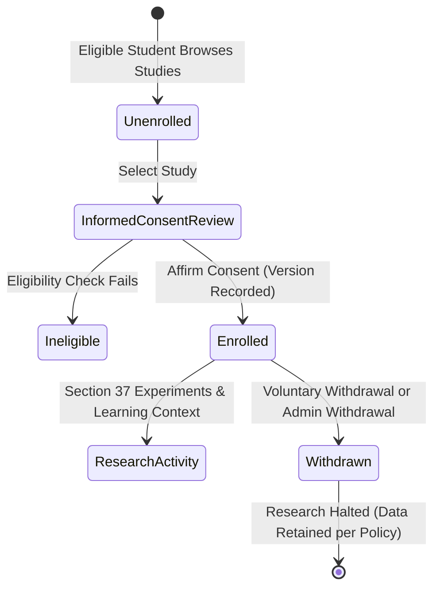

# FLUENTT Research Data Flow and Participant Management

## 1. Overview and Ethical Boundary

The FLUENTT research infrastructure supports rigorous, controlled scientific studies investigating adaptive spaced repetition algorithms (such as FSRS-6 and Enhanced Spaced Repetition / FIFAKT) and pronunciation assessment in low-resource and multilingual contexts (Tagalog/Filipino and English).

> [!IMPORTANT]
> **Ethics Approval Disclaimer**: Software consent recording and lifecycle management within the application do **not** constitute or replace institutional ethics review board (IRB / ERC) approval. All research protocols must receive formal independent ethics clearance prior to participant recruitment and experimental deployment.

---

## 2. Participant Lifecycle

1. **Eligibility Determination**:
   - The learner must have an active student account (`personal_student` or `school_student`).
   - The learner must not already be enrolled in or previously withdrawn from the study (re-enrollment is prohibited under strict protocol integrity).
   - The study must be in `active` status and below target participant capacity.
2. **Informed Consent Review**:
   - The participant is presented with the approved protocol consent document, including research purpose, procedures, voluntary nature, withdrawal rights, confidentiality guarantees, and data retention disclosures.
   - Document versioning (`protocol_version` and `consent_version`) is explicitly recorded.
3. **Atomic Enrollment & Pseudonymization**:
   - A cryptographically randomized pseudonymous participant code (`P-TAG-XXXXXX` or `P-ENG-XXXXXX`) is generated.
   - A `ResearchParticipant` record is created in the public schema with `enrollment_status = 'enrolled'`.
   - The identifying link between the user and the participant record is stored exclusively in `research_private.research_identity_links`.
   - An append-only consent record is created in `research_private.research_consent_records` with `status = 'granted'`.
   - A dedicated `LearningContext` is created with `kind = 'research'`, `participant_id` set, and both `student_id` and `class_id` set to `NULL` (enforced by database constraint `ck_learning_contexts_context_scope`).
   - An immutable `ResearchEvent` (`participant_enrolled`) and an `AuditLog` entry are written.
4. **Voluntary and Administrative Withdrawal**:
   - Participants may voluntarily withdraw at any time directly through the mobile interface or via research administrators.
   - Upon withdrawal, `enrollment_status` is updated to `'withdrawn'`, `withdrawn_at` is recorded, and an append-only consent record with `status = 'withdrawn'` is inserted.
   - Future experimental sessions are immediately halted. Historical data is preserved in pseudonymized form per the approved retention schedule (`research-retention-v1`).

---

## 3. Data Privacy and Schema Isolation

### 3.1 Schema Separation
FLUENTT enforces a strict architectural boundary between ordinary classroom operations and experimental research data:

| Entity | Schema | Access Restriction | Purpose |
| :--- | :--- | :--- | :--- |
| `users` | `public` | Standard Auth | Ordinary user account credentials and profile metadata. |
| `research_studies` | `public` | Public read (active) / `research.read` | Study definitions, protocol versions, quotas, and state. |
| `research_participants` | `public` | Public read (status) / `research.read` | Pseudonymous code, enrollment status, timestamps. No user IDs. |
| `learning_contexts` | `public` | Session-scoped | Research contexts have `participant_id` only (`student_id IS NULL`). |
| `research_identity_links` | `research_private` | `research.manage` ONLY | Identity mapping between `user_id` and `participant_id`. |
| `research_consent_records` | `research_private` | `research.manage` ONLY | Immutable consent audit log with `fluentt_append_only` trigger. |

### 3.2 Append-Only Database Guarantees
The `research_private.research_consent_records` table is guarded by the database trigger `fluentt_append_only()`. Any attempt to execute `UPDATE` or `DELETE` on consent records is rejected at the database level. Every lifecycle transition (grant or withdrawal) produces an independent, immutable `INSERT`.

### 3.3 Identity Link Safeguards
Access to the identity link table (`research_private.research_identity_links`) is strictly restricted to operators holding the `research.manage` permission. Any identity revelation action (e.g., via administrative audit) requires explicit justification and triggers a high-severity `AuditLog` event (`research.identity_revealed`) recording actor identity, participant ID, client IP, and timestamp.

---

## 4. Retention Policy (`research-retention-v1`)

1. **Scientific Integrity**: In accordance with academic research standards and thesis methodology Chapter 3, learning interactions and audit records collected prior to participant withdrawal are permanently retained in pseudonymized form to preserve statistical reproducibility and historical accountability.
2. **Post-Withdrawal Processing**: Upon confirmed withdrawal, the participant's status is set to `'withdrawn'`. No further research tasks, adaptive algorithm evaluations, or surveys may be scheduled or delivered to the participant.
3. **No Automatic Account Conversion**: Classroom students are never silently converted into research participants. Educational records (assignments, grades, submissions) are completely separated from research contexts.

---

## 5. Controlled Research Experiment Infrastructure (Section 37)

### 5.1 Approved Comparison Groups & Scheduler Bindings
Per approved thesis Chapter 3 experimental methodology, each research study evaluates two distinct spaced repetition conditions:
1. **Control Condition (`sm2_control`)**:
   - Algorithm: Classic SuperMemo-2 (SM-2, `sm2-thesis-v1.0`).
   - Parameters: Initial $EF = 2.50$, $EF_{\min} = 1.30$, interval sequence $I(1) = 1, I(2) = 6, I(n) = I(n-1) \times EF$.
   - Failure lapse: resets repetition count $n = 0$ and interval $I = 1$ day.
   - Fixed rating scale: $q \in \{1, 3, 4, 5\}$ mapped from subjective recall buttons.
2. **Experimental Condition (`esr_experimental`)**:
   - Algorithm: Enhanced Spaced Repetition (ESR, `fifakt-hybrid-v1.0`) fusing FSRS-6 with FIFAKT knowledge tracing.
   - Dynamic parameters: predicted recall probability $\hat{p} \in [0.01, 0.99]$, difficulty $D \in [1.0, 10.0]$, stability $S > 0$.
   - Stability multiplier $\alpha \in [0.80, 1.25]$ modulated by simulated knowledge state; failure clamp enforces $\alpha_{\text{eff}} \le 1.0$ and 1-day interval reset.

### 5.2 Allocation Methodology & Reproducibility
- **Permuted Block Randomization**: Balanced 1:1 allocation using permuted blocks of size 4 ($[A, A, B, B]$ shuffled).
- **Target Capacity**: Exactly 15 participants per group (30 total per study), strictly enforced by database queries before allocation.
- **Reproducibility Metadata**: Allocation seed or timestamp hash is immutably recorded in `ResearchGroupAssignment.allocation_metadata` and the associated `ResearchEvent` (`participant_allocated`).
- **Idempotency & Replay Protection**: Repeated allocation requests for the same participant safely return the existing assignment without re-allocating or altering study balance.
- **Withdrawal Exclusion**: Withdrawn participants cannot be allocated to experimental groups (`participant_withdrawn` error 422).

### 5.3 Participant Blinding Invariant
- **Double-Blind Presentation**: Mobile client and participant-facing endpoints receive `condition_blinded = "standard_research_track"`.
- **Key Stripping**: The actual underlying algorithm identity (`sm2_control` vs `esr_experimental`) is never returned in participant DTOs.
- **Unblinded Access**: Only authorized administrators with `research.read` permission can view unblinded group summaries via `/admin/research/studies/{id}/groups`.

### 5.4 Protocol Deviation & Reassignment Handling
- **Database Trigger Protection**: `research_group_assignments` is protected by `fluentt_append_only()` trigger, forbidding SQL `UPDATE` or `DELETE`.
- **Supersedes Chain**: Protocol adjustments (e.g. approved IRB crossover) create an append-only row with `assignment_number = prev.assignment_number + 1`, `supersedes_id = prev.id`, mandatory deviation reason (min 10 chars), and audit logging.

### 5.5 Assessment Battery & Single-Attempt Policy
- **Assessment Kinds**:
  1. `pre_test`: Pre-intervention baseline instrument.
  2. `learning_level` 1–5: Formative milestone assessments for curriculum levels 1 through 5.
  3. `post_test`: Post-intervention summative instrument.
  4. `delayed_retention`: 14-day delayed retention evaluation.
  5. `pronunciation`: Acoustic Goodness-of-Pronunciation (GOP) speech evaluation.
- **Progression Gating**: Subsequent milestone assessments remain locked until the participant completes the prerequisite prior assessment.
- **Single-Attempt Enforcement**: Only 1 completed attempt is permitted per assessment instrument (`single_attempt_exceeded` error 422).
- **Key-Free Projection**: `expected_answer`, accepted variations, and private grading rubrics are stripped from participant payloads.
- **Scoring Engine**: Objective-exact evaluation for multiple choice, true/false, identification, and fill-in-the-blank items; GOP acoustic scoring for pronunciation items.

### 5.6 Automated Scheduler Routing for Research Reviews
- When `record_review_event` or `get_due_reviews` is invoked with `context_type == "research"`, the system automatically resolves the participant's assigned research group and directs reviews to the configured SM-2 or FIFAKT scheduler, preserving strict group isolation.

---

## 6. Research Analytics, Dashboards & Secure Exports (Section 38)

### 6.1 Scientific Ethics & Descriptive Analysis Mandate
In strict accordance with the approved Chapter 3 educational statistics plan, Section 38 provides reproducible, transparent descriptive reporting and privacy-controlled dataset exports:
- **Zero Fabricated Inferential Statistics**: The system computes purely descriptive measures ($N$, Mean, Median, Sample Standard Deviation $s = \sqrt{\frac{\sum (x - \bar{x})^2}{n - 1}}$, Min, Max, and Mean Percentage). Absolutely no inferential hypotheses, $p$-values, effect sizes (e.g. Cohen's $d$, $\eta^2$), or confidence intervals are fabricated or asserted without an approved confirmatory inference pipeline.
- **Small-Cell Privacy Threshold ($N < 5$)**: Any metric cell or condition subgroup with fewer than 5 observations ($N < 5$) is automatically flagged (`is_small_cell = true`). In user interfaces, small cells display prominent privacy warning badges to mitigate inadvertent deductive re-identification of individual learners.
- **Traceable Primary Records**: All aggregates are computed on-demand directly from immutable primary tables (`research_participants`, `research_group_assignments`, `research_assessment_results`, `vocabulary_review_events`). No intermediary derived tables or speculative models are stored.

### 6.2 CONSORT Participant Flow Metrics
Participant progression through the study is structured according to CONSORT guidelines:
- **Total Enrolled ($N_{\text{enrolled}}$)**: Participants with confirmed consent/assent records and active identity links.
- **Allocated to Conditions**:
  - Control Group ($N_{\text{ctrl}}$): Assigned to `sm2_control` (Classic SuperMemo-2).
  - Experimental Group ($N_{\text{exp}}$): Assigned to `esr_experimental` (Enhanced Spaced Repetition / FIFAKT).
- **Active In Progress ($N_{\text{active}}$)**: Actively participating learners in `enrolled` status.
- **Completed Study ($N_{\text{comp}}$)**: Participants who successfully submitted the terminal `post_test` assessment.
- **Withdrawn ($N_{\text{withdrawn}}$)**: Breakdown categorized by documented withdrawal reason (`voluntary_withdrawal`, `scheduling_conflict`, `technical_issue`, `investigator_initiated`, etc.).
- **Derived Flow Rates**:
  $$\text{Completion Rate} = \frac{N_{\text{comp}}}{N_{\text{enrolled}}} \times 100\%$$
  $$\text{Dropout Rate} = \frac{N_{\text{withdrawn}}}{N_{\text{enrolled}}} \times 100\%$$

### 6.3 Within-Subject Learning Gains & Retention Loss
To evaluate the pedagogical impact of the adaptive spaced repetition scheduler against the control baseline, paired descriptive differences are computed across individual participants:
1. **Absolute Learning Gain**:
   $$\Delta_{\text{abs}} = \text{Score}_{\text{post\_test}} - \text{Score}_{\text{pre\_test}}$$
2. **Hake's Normalized Learning Gain ($g$)**:
   Computes the proportion of potential score improvement realized by the participant:
   $$g = \frac{\text{Score}_{\text{post\_test}} - \text{Score}_{\text{pre\_test}}}{\text{Maximum Possible} - \text{Score}_{\text{pre\_test}}}$$
   *(If baseline score is already at maximum, $g = 0.0$)*.
3. **Delayed Retention Loss (Decay)**:
   Measures memory decay over a 14-day dormant interval following study completion:
   $$\Delta_{\text{decay}} = \text{Score}_{\text{post\_test}} - \text{Score}_{\text{delayed\_retention}}$$
   *(A lower retention loss indicates superior long-term memory stabilization)*.

### 6.4 Spaced Repetition Review Telemetry
Aggregated from audited `VocabularyReviewEvent` records per condition:
- **Total Review Events**: Total count of flashcard / vocabulary review transactions.
- **Active Learners**: Count of distinct participants with at least one recorded review.
- **Mean Reviews per Learner**: $\frac{\text{Total Reviews}}{\text{Active Learners}}$.
- **Retention Accuracy (%)**: Percentage of reviews rated `good` or `easy` (successful memory recall).
- **Mean Response Duration**: Average reaction latency in milliseconds from card prompt to rating.
- **Lapse Count**: Number of reviews rated `again` (memory failure requiring schedule reset).
- **Rating Distribution**: Exact count breakdown across four ratings: `again`, `hard`, `good`, `easy`.

### 6.5 Secure Research Export Datasets
Three analysis-ready tabular CSV exports and one JSON variable codebook are made available to authorized researchers holding `research.read` permission:

| Dataset | Filename | Grain | Key Columns |
| :--- | :--- | :--- | :--- |
| **Participant Longitudinal** | `fluentt_study_{id}_participants_longitudinal.csv` | 1 row per participant | `participant_code`, `study_code`, `condition`, `enrollment_status`, `enrolled_at`, `withdrawn_at`, `withdrawal_reason`, `pre_test_score`, `level_tests_completed`, `post_test_score`, `delayed_retention_score`, `pronunciation_score`, `absolute_learning_gain`, `normalized_learning_gain`, `retention_loss` |
| **Assessment Attempts** | `fluentt_study_{id}_assessments.csv` | 1 row per attempt | `result_id`, `participant_code`, `study_code`, `condition`, `assessment_kind`, `assessment_title`, `instrument_version`, `attempt_number`, `status`, `score`, `maximum_score`, `percentage`, `response_duration_ms`, `completed_at` |
| **Review Events Log** | `fluentt_study_{id}_reviews.csv` | 1 row per review event | `event_id`, `participant_code`, `study_code`, `condition`, `vocabulary_term`, `vocabulary_language`, `recall_rating`, `is_correct`, `response_duration_ms`, `previous_interval_days`, `resulting_interval_days`, `reviewed_at` |
| **Data Dictionary** | `data-dictionary` | JSON schema | Complete variable catalog with definitions, data types, measurement windows, missing-data codes (`NA`, `WITHDRAWN`, `EXCLUDED`), and privacy rules. |

### 6.6 Data Privacy, CWE-1236 Sanitization & Audit Logging
1. **Spreadsheet Formula Injection Prevention (CWE-1236)**:
   Any exported text cell beginning with dangerous formula invocation characters (`=`, `+`, `-`, `@`, `\t`, `\r`, `%`) is sanitized by prepending a single quote (`'`), neutralizing automatic macro execution in Microsoft Excel, Google Sheets, or LibreOffice Calc. Valid signed floating-point numbers (e.g. `-1.50`, `+4.00`) are safely identified and preserved as numbers.
2. **Strict Pseudonymization**:
   Exports exclusively expose randomized, stable research codes (`P-TAG-XXXXXX`). Student usernames, full names, email addresses, password hashes, mobile device IDs, and raw audio blobs are strictly forbidden and excluded from export schemas.
3. **Mandatory Audit Logging**:
   Every dataset generation triggers an immutable `AuditLog` entry (`action = "research.dataset_exported"`) recording the requesting administrator ID, study ID, dataset name, client IP, and UTC timestamp.

